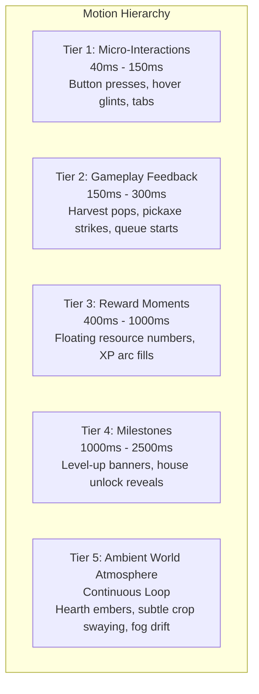
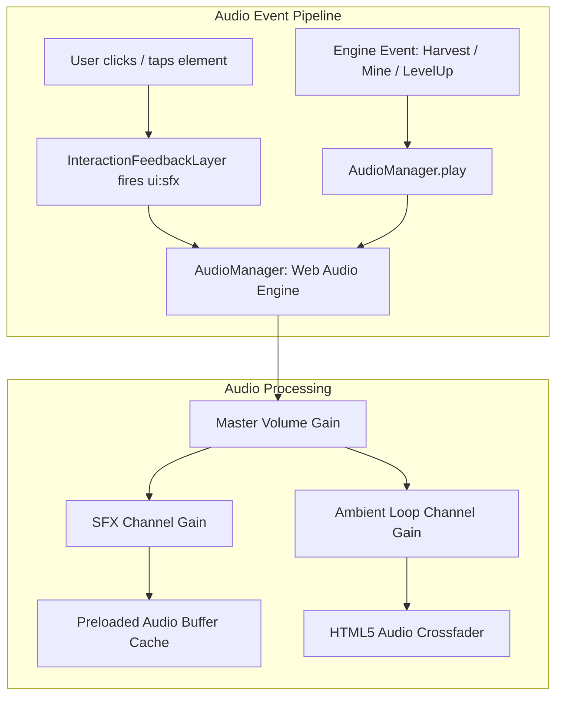

# SALVATION — AAA-QUALITY STUDIO AUDIT & IMPLEMENTATION ROADMAP
## DELIVERABLE 06: ANIMATIONS, MOTION DESIGN & INTERACTIVE AUDIO PLAN

**Studio Disciplines:** Lead Motion Designer, Frontend Animation Engineer & Audio Director  
**Aesthetic Standard:** Cozy Gothic Warmth — Tactile Weight, Responsive Snappiness & Atmospheric Audio

---

### 1. MOTION DESIGN PHILOSOPHY & HIERARCHY

In a management simulation game, animation must never get between the player and their intent. Animations that delay interactions, block clicks, or create layout thrashing immediately produce player friction. 

Every motion cue in Salvation must serve one of three purposes:
1. **Confirmation:** Instantly acknowledging player input (press states, click ripples).
2. **State Clarity:** Clearly communicating transitions (seed to sprout, ready to harvest, cooling down).
3. **Reward Reinforcement:** Providing satisfying tactile feedback for milestone accomplishments (harvest floating numbers, geode shattering, level-up banners).



---

### 2. INTERACTION & ANIMATION MATRIX

| Interaction | Trigger | Visual Behavior | Duration | Easing | Interruption Rule | Reduced Motion Fallback |
|---|---|---|---|---|---|---|
| **Button Tap / Click** | `pointerdown` / `pointerup` | Scale down to `0.97`, slight brightness dip, followed by elastic return (`1.0`) with gold border flash. | 120ms total | `cubic-bezier(0.2, 0.8, 0.4, 1)` | Instantly interruptible by pointer cancel or rapid multi-clicks. | Border color highlight change only, no scale transform. |
| **Plot Harvest** | Click "Reap" on ready plot | Crop sprite scales up `1.15x`, fades upward with golden particle glints; plot resets to fallow soil texture with a gentle dust puff. | 250ms | `cubic-bezier(0.34, 1.56, 0.64, 1)` (overshoot) | Non-blocking. Next plot can be clicked immediately. | Instant fade-out (80ms), zero particle bursts. |
| **Pickaxe Strike** | Click "Mine" on ore node | Node shakes with horizontal impact recoil (`±4px`), emits 3-5 spark sparks along impact vector, crack lines deepen. | 140ms | `cubic-bezier(0.1, 0.9, 0.2, 1)` | Rapid clicks reset the recoil animation without queuing delay. | Subtle white flash overlay (60ms), no screen/node shake. |
| **Node Shatter** | Ore durability reaches 0 | Node collapses with radial shard explosion; central crystalline gem floats upward into the player vault icon. | 600ms | `cubic-bezier(0.22, 1, 0.36, 1)` | Non-blocking. New node spawn button enables immediately. | Shards instantly dissolve; reward summary modal appears directly. |
| **Craft Completion** | Workshop queue timer finishes | Workstation emits a warm steam puff and golden chimney glow; completed item card pulses with an amber focus ring. | 450ms | `ease-out` | Clicking "Claim" immediately cancels animation and awards item. | Static notification badge appears, no steam/particle effects. |
| **Reward Floats** | Harvest, mine, or quest turn-in | Floating text (`+3 Turnip`, `+24 XP`) floats upward `32px` from click anchor with a subtle horizontal jitter, fading out smoothly. | 1000ms | `cubic-bezier(0.16, 1, 0.3, 1)` | Managed by `RewardFloatProvider`. Multiple items stagger by 100ms. | Static toast notification in bottom right; no floating DOM nodes. |
| **Level-Up Milestone** | Player / Farm / Mining level advances | Screen dims slightly (20% dark vignette); ornate Sunforge crest descends from top with radiant light rays, displaying "Level Up!" and unlocked perks. | 2200ms (auto-dismiss or click to skip) | `cubic-bezier(0.16, 1, 0.3, 1)` | Click anywhere or press Escape to dismiss instantly. | Static modal popup with no rotation or ray animations. |
| **Ambient Hearth Glow** | Idle state | Subtle breathing luminance modulation on fireplaces and lanterns (`opacity: 0.85` to `1.0`). | 4000ms loop | `easeInOutSine` | Runs entirely on GPU via CSS keyframes with `will-change: opacity`. | Static 90% opacity, continuous animation completely disabled. |

---

### 3. ACCESSIBILITY & PERFORMANCE COMPLIANCE

Every animation must adhere strictly to the CSS `prefers-reduced-motion` media query:

```css
@media (prefers-reduced-motion: reduce) {
  *,
  *::before,
  *::after {
    animation-duration: 0.01ms !important;
    animation-iteration-count: 1 !important;
    transition-duration: 0.01ms !important;
    scroll-behavior: auto !important;
  }

  .reward-float {
    display: none !important; /* Replaced by standard static toasts */
  }

  .dashboard-orb {
    display: none !important; /* Eliminates background blur animations */
  }
}
```

---

### 4. ANIMATION TECHNOLOGY EVALUATION

| Technology Candidate | Bundle Impact | Strengths | Weaknesses | Studio Recommendation |
|---|---|---|---|---|
| **Pure CSS Keyframes & Tailwind v4 Utilities** | **0 KB** | Zero JS runtime overhead, runs entirely on browser compositor thread (60+ FPS even on low-end phones), native hardware acceleration. | Complex sequencing and dynamic coordinate anchoring (floating rewards from click coordinates) require JS glue. | **PRIMARY SOLUTION** for 85% of UI: button states, panel reveals, ambient hearth glows, and progress bars. |
| **Web Animations API (WAAPI)** | **0 KB** | Native browser API, full imperative control (`element.animate()`), cancelable, zero dependencies. | Slightly more verbose syntax for complex staggered sequences. | **RECOMMENDED** for dynamic coordinate animations: floating numbers, flying loot icons, and click sparks. |
| **Motion for React (Framer Motion v12)** | **~32 KB gzipped** | Declarative layout transitions (`layoutId`), gesture recognition, easy spring physics. | Increases initial bundle size by ~30 KB; potential React re-render overhead on high-frequency mining clickers. | **EVALUATE FOR SPRINT 3:** Adopt strictly if layout morphing (e.g., inventory drag-and-drop or accordion resizing) requires spring physics. Avoid for basic button/card clicks. |

---

### 5. INTERACTIVE AUDIO SYSTEM ARCHITECTURE

#### The Current Deficiency
The repository is completely mute. While `src/shared/feedback/InteractionFeedbackLayer.jsx` dispatches a custom DOM event (`ui:sfx`), there are **zero audio files, zero audio libraries, and zero event listeners** anywhere in the project.

#### Audio Engine Design: "The Hearth Soundscape"
The audio experience must evoke **Cozy Dark-Fantasy Warmth**: crackling cedar fires, rain tapping on slate shingles, acoustic lute strings, heavy resonant iron impacts, and bright, crystalline coin clinks.



#### Proposed `AudioManager.js` Implementation Blueprint
A zero-dependency Web Audio API singleton that preloads compressed Opus/WebM audio sprites and prevents audio clipping through smart voice concurrency:

```javascript
// src/core/audio/AudioManager.js
class AudioManager {
  constructor() {
    this.ctx = null;
    this.buffers = new Map();
    this.masterGain = null;
    this.sfxGain = null;
    this.musicGain = null;
    this.isMuted = localStorage.getItem('salvation_audio_muted') === 'true';
  }

  init() {
    if (this.ctx) return;
    const AudioContext = window.AudioContext || window.webkitAudioContext;
    this.ctx = new AudioContext();
    this.masterGain = this.ctx.createGain();
    this.sfxGain = this.ctx.createGain();
    this.musicGain = this.ctx.createGain();

    this.sfxGain.connect(this.masterGain);
    this.musicGain.connect(this.masterGain);
    this.masterGain.connect(this.ctx.destination);

    // Listen to global UI interaction feedback
    window.addEventListener('ui:sfx', (e) => {
      this.playSfx(e.detail?.type || 'tap');
    });
  }

  playSfx(cueName, { pitchVariance = 0.08, volume = 1.0 } = {}) {
    if (this.isMuted || !this.ctx) return;
    if (this.ctx.state === 'suspended') this.ctx.resume();

    const buffer = this.buffers.get(cueName);
    if (!buffer) return;

    const source = this.ctx.createBufferSource();
    source.buffer = buffer;
    
    // Slight pitch randomization to prevent machine-gun monotony
    const randomPitch = 1 + (Math.random() * 2 - 1) * pitchVariance;
    source.playbackRate.value = randomPitch;

    const gainNode = this.ctx.createGain();
    gainNode.gain.value = volume;

    source.connect(gainNode);
    gainNode.connect(this.sfxGain);
    source.start(0);
  }
}
```

---

### 6. PRIORITY SOUND ASSET INVENTORY

All sound assets must be delivered in compressed `.webm` / `.ogg` format (with `.mp3` fallback) to minimize bandwidth.

| Cue ID | Category | Description | Duration | Frequency / Concurrency | Volume Level |
|---|---|---|---|---|---|
| `ui_tap` | UI Micro | Subtle wooden peg tap with warm acoustic resonance. | 45ms | Very High (120ms throttle) | -12 dB |
| `ui_tab_switch` | UI Micro | Soft parchment page turn / vellum flutter. | 180ms | High | -14 dB |
| `farm_seed_plant` | Gameplay | Earthy soil scoop and seed scatter. | 220ms | Medium | -9 dB |
| `farm_crop_harvest`| Gameplay | Crisp foliage snap followed by a bright chime. | 320ms | High (Multi-harvest pitch stacks) | -6 dB |
| `animal_collect` | Gameplay | Gentle rustic wooden bucket fill / clink. | 350ms | Low | -8 dB |
| `mine_pick_strike` | Gameplay | Sharp iron pick striking hard granite with stone fracture. | 180ms | Very High (Pitch variance ±10%) | -4 dB |
| `mine_crit_spark` | Gameplay | Resonant crystalline ping with reverberant tail. | 450ms | Medium | -5 dB |
| `mine_shatter` | Gameplay | Heavy cavernous rock collapse with mineral geode crack. | 750ms | Low | -3 dB |
| `workshop_hammer` | Gameplay | Anvil strike with metallic sizzle and hot embers. | 400ms | Medium | -6 dB |
| `market_gold_coins`| Economy | Satisfying leather pouch jingling with heavy brass/gold coins. | 500ms | Medium | -6 dB |
| `quest_complete` | Reward | Low gothic cello chord resolving into a bright bell overtone. | 1200ms | Rare | -4 dB |
| `milestone_levelup`| Milestone | Resonant brass horn fanfare accompanied by a radiant solar burst. | 2400ms | Rare | -2 dB |
| `ambience_estate` | Ambient Loop | Crackling fireplace, faint distant wind in the eaves, quiet night crickets. | 60s loop | Continuous background | -18 dB |
| `ambience_mines` | Ambient Loop | Dripping water echo, deep subterranean rumble, subtle crystal hum. | 60s loop | Continuous background | -20 dB |
