# SALVATION — AAA-QUALITY STUDIO AUDIT & IMPLEMENTATION ROADMAP
## DELIVERABLE 09: ART & ASSET PRODUCTION STRATEGY

**Studio Disciplines:** Art Director, Technical Artist & Audio Designer  
**Benchmark Aesthetic:** "Gothic Hearth" (Dark illuminated manuscript framing, warm copper/amber hearth lighting, grounded tactile tools)

---

### 1. ASSET PIPELINE & PRODUCTION METHODOLOGY

#### The Small-Team / Solo Developer Asset Strategy
For a small indie team or solo developer, attempting to hand-paint thousands of 3D models or custom frame-by-frame 2D sprites is fatal to project velocity. Conversely, downloading mismatched asset packs results in a chaotic "Frankenstein" visual style that destroys immersion.

**The Hybrid Production Pipeline:**
1. **Curated Generative Concepting (Midjourney v6 / Flux):** Generate raw high-resolution fantasy elements using a strictly locked prompt bible and seed consistency.
2. **Manual Cleanup & Vector/Alpha Matting:** Strip backgrounds cleanly in Photoshop/GIMP, fix anatomical/perspective artifacts, and normalize lighting vectors (all items lit from top-left with warm rim light).
3. **Palette Harmonization:** Run all sprites through a unified Photoshop color-grading LUT (The "Sunforge Filter": crushed deep blacks `#08090D`, elevated midtones, warm ember highlights `#E5B25D`).
4. **Automated Compression Pipeline:** Convert finalized assets to WebP/AVIF format with strict dimension and byte budgets.

```mermaid
graph LR
    PromptBible[Locked Style Prompt Bible] --> GenAI[Generative Exploration: Flux/Midjourney]
    GenAI --> HumanCuration[Art Director Curation: 1 in 10 Selected]
    HumanCuration --> ManualClean[Photoshop / GIMP: Edge Cleanup & Polish]
    ManualClean --> ColorGrade[Unified Sunforge Color LUT]
    ColorGrade --> WebPOptimizer[Automated WebP/AVIF Compression Pipeline]
    WebPOptimizer --> GameClient[Optimized Browser Asset Delivery]
```

---

### 2. CLEANUP OF CURRENT REPOSITORY ASSETS

Our audit identified several raw, unedited development files left sitting directly in `public/`:
1. `public/pickaxe/20260210_1041_Image Generation_simple_compose_01kh3etckxfwk9a480hc297kd6.webp` — Unrenamed raw AI download. Must be evaluated or deleted.
2. `public/farm/seasons/Autumnpng-removebg-preview.webp` and `Spring-removebg-preview.webp` — Raw web-tool scrape filenames. Must be renamed to clean semantic filenames: `autumn_crest.webp`, `spring_crest.webp`.
3. `public/cities/*.png` — 6 uncompressed PNGs totaling 15.4 MB. Must be compressed to WebP (under 200 KB each).
4. `public/animals.webp` and `public/farm/hub/animals.webp` — Duplicate identical files. Consolidate into single shared location.

---

### 3. PRIORITIZED ASSET INVENTORY & PRODUCTION MATRIX

#### Tier 1: P0 Blocker Assets (Immediate Fixes)
| Asset Name | Target Path | Specs | Intended Usage | Effort |
|---|---|---|---|---|
| **Mythril Pickaxe Sprite** | `/pickaxe/mythril_pickaxe.webp` | 256x256 WebP, transparent alpha, < 40 KB | Fixes broken image reference in Tier 5 mining. | 0.5 Days |
| **Voidsteel Pickaxe Sprite** | `/pickaxe/voidsteel_pickaxe.webp` | 256x256 WebP, transparent alpha, < 40 KB | Fixes broken image reference in Tier 6 mining. | 0.5 Days |
| **Starforge Pickaxe Sprite** | `/pickaxe/starforge_pickaxe.webp` | 256x256 WebP, transparent alpha, < 40 KB | Fixes broken image reference in Tier 7 mining. | 0.5 Days |
| **Optimized City Backdrops** | `/cities/{Eldoria,Valoria,Drakmor}City.webp` | 1920x1080 WebP, 80% quality, < 250 KB each | Replaces 15.4 MB PNGs in Character Creation. | 0.5 Days |

#### Tier 2: P1 Core Gameplay Sprites & Item Icons
| Asset Name | Target Path | Specs | Intended Usage | Effort |
|---|---|---|---|---|
| **Crop Growth Stages** (5 crops x 3 stages = 15 sprites) | `/farm/crops/{cropId}_{seed/sprout/mature}.webp` | 128x128 WebP, transparent alpha, < 25 KB each | Visual progression on Farm Plots (Turnip, Wheat, Herb, Moonberry, Sunroot). | 2.5 Days |
| **Crafted Workshop Goods** (11 items) | `/workshop/items/{itemId}.webp` | 128x128 WebP, transparent alpha, < 20 KB each | Replaces `noimage.webp` on bars, stews, cloth, and elixirs. | 2.0 Days |
| **Equipment & Relic Gear** (6 items) | `/gear/{gearId}.webp` | 128x128 WebP, transparent alpha, < 25 KB each | Replaces `noimage.webp` on market and vault equipment. | 1.5 Days |
| **Livestock Avatars** (6 breeds) | `/farm/animals/{animalId}.webp` | 256x256 WebP, transparent alpha, < 45 KB each | Animal pasture cards and market purchase cards. | 1.0 Days |
| **Interactive Ore Nodes** (6 tier nodes) | `/mining/nodes/node_tier_{1-6}.webp` | 320x320 WebP, transparent alpha, < 50 KB each | Clickable ore rocks in the Active Mining Quarry. | 1.5 Days |

#### Tier 3: P2 Sound Effects & Ambience Matrix
| Asset Name | Target Path | Specs | Intended Usage | Effort |
|---|---|---|---|---|
| **UI Interaction Pack** (5 SFX) | `/audio/sfx/ui_{tap,tab,toggle,open,close}.webm` | 48kHz, mono Opus/WebM, < 20 KB each | Subtle wooden clicks and vellum page turns. | 1.0 Days |
| **Harvest & Farming Pack** (4 SFX) | `/audio/sfx/farm_{plant,harvest,feed,collect}.webm` | 48kHz, mono Opus/WebM, < 35 KB each | Soil scoops, crisp foliage snaps, and bucket chimes. | 1.0 Days |
| **Mining & Cavern Pack** (4 SFX) | `/audio/sfx/mine_{strike,crit,shatter,gem}.webm` | 48kHz, mono Opus/WebM, < 40 KB each | Resonant iron pick strikes and cavernous shattering. | 1.0 Days |
| **Workshop & Economy Pack** (4 SFX) | `/audio/sfx/econ_{anvil,bubble,coins,level}.webm` | 48kHz, mono Opus/WebM, < 50 KB each | Anvil hammering, gold clinking, and trumpet fanfare. | 1.0 Days |
| **Ambient Loops** (2 tracks) | `/audio/ambient/{estate_hearth,deep_mine}.webm` | 48kHz, stereo Opus/WebM, seamless 60s loop, < 450 KB each | Background environmental immersion. | 2.0 Days |

#### Tier 4: P3 Decorative Environmental Polish
| Asset Name | Target Path | Specs | Intended Usage | Effort |
|---|---|---|---|---|
| **Estate Renovation Vignettes** (4 stages) | `/houses/estate_stage_{1-4}.webp` | 800x450 WebP, < 80 KB each | Visual restoration of the ancestral manor. | 2.0 Days |
| **Faction Crests & Banners** (3 cities) | `/factions/{eldoria,valoria,drakmor}_crest.webp` | 256x256 WebP, < 30 KB each | Profile and Chronicle headers. | 1.0 Days |
| **NPC Mentor Portraits** (5 characters) | `/npc/{elric,selyse,moira,bran,gideon}.webp` | 256x256 WebP, < 40 KB each | Dialogue banners and Chronicle quest milestones. | 2.0 Days |

---

### 4. TECHNICAL ASSET SPECIFICATIONS & CONVENTIONS

1. **File Naming Standard:** All filenames must use strict lower-case kebab-case: `[category]-[name]-[variant].[ext]` (e.g., `ore-voidsteel-raw.webp`, `pickaxe-mythril-icon.webp`). Prohibit spaces, timestamps, and camera tool prefixes.
2. **Color Space & Gamma:** Standard sRGB color profile embedded.
3. **Resolution Standards:**
   - Item Icons / Equipment: **128 x 128 px** (rendered at 48px–64px on screen for Retina sharpness).
   - Character / NPC Avatars: **256 x 256 px** (rendered at 80px–120px).
   - Environmental Backdrops: **1920 x 1080 px** (compressed WebP, max byte target: 220 KB).
4. **Audio Encoding Standard:**
   - Format: **WebM / Opus** (primary) with fallback to **AAC / M4A**.
   - Sample Rate: **48,000 Hz**.
   - Channels: **Mono** for SFX (spatial/panning efficiency), **Stereo** for ambient music loops.
