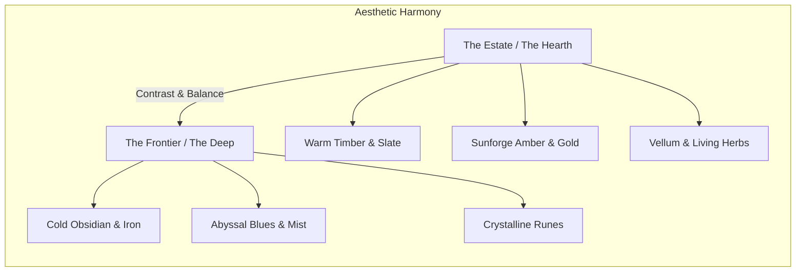
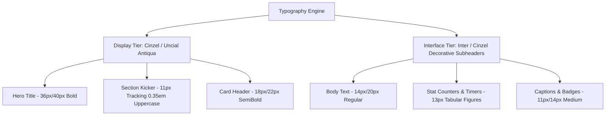
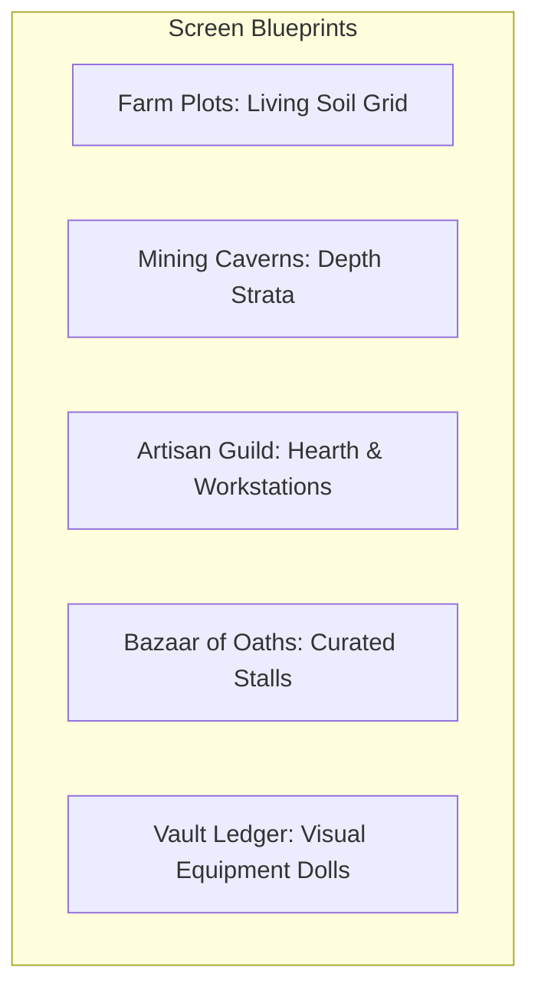

# SALVATION — AAA-QUALITY STUDIO AUDIT & IMPLEMENTATION ROADMAP
## DELIVERABLE 03: CREATIVE DIRECTION & UI/UX DESIGN SYSTEM

**Studio Discipline:** Creative Direction, Visual Identity & Interaction Design  
**Art Direction Benchmark:** "Gothic Hearth" — Cozy Dark-Fantasy Estate Reclamation  
**References & Inspirations:** *Graveyard Keeper* (cozy macabre utility), *Darkest Dungeon* (stark gothic framing), *Sunless Skies* (rich Victorian/arcane typography), *Diablo II Resurrected* (grounded dark metals and stone).

---

### 1. CREATIVE VISION STATEMENT & TARGET PLAYER EXPERIENCE

#### Creative Vision Statement
> *"Salvation is not about conquering an empire through war; it is about keeping the flame alive when the heavens have gone cold. You are an Oathbound Warden reclaiming an ancient estate on the edge of the known world—nurturing the living soil, unearthing forgotten ores in the deep dark, forging relics in the hearth-glow, and binding the scattered embers of humanity into a lasting sanctuary."*

#### Target Player Experience
- **Atmospheric Solace:** A sense of warmth, safety, and cozy industry inside the estate, set against the vast, mysterious backdrop of a shattered world.
- **Tactile Mastery:** Every interaction—breaking a vein of silver, harvesting golden sunroot, pulling a freshly tempered ingot from the forge—must feel physical, deliberate, and satisfying.
- **Clarity Without Dashboardification:** A game interface that immerses the player in an ancient illuminated chronicle rather than presenting a sterile corporate analytics dashboard.

---

### 2. VISUAL IDENTITY: "GOTHIC HEARTH"

#### Rationale for Selected Direction
The current application suffers from an identity conflict: it attempts to be a dark fantasy game by applying generic dark-gray backgrounds (`bg-gray-900`) and yellow borders, but executes it with SaaS-style cards, flat pills, and an unreadable gothic font (`Tagesschrift`) slapped globally across every button, tab, and numeric label.

**The "Gothic Hearth" direction resolves this by establishing two distinct aesthetic zones:**
1. **The Safe Estate (Warm Hearth & Natural Materials):** Deep slate stone, ironwork filigree, warm amber candlelight, aged vellum parchment, rich timber, and living greenery.
2. **The Deep Frontiers (Crystalline Arcana & Cold Shadows):** Cold obsidian, glowing rune veins, bioluminescent moss, mist, and deep abyssal blues.



---

### 3. TYPOGRAPHY SYSTEM

#### The Problem with Current Typography
`index.html` loads Google Font `Tagesschrift` and applies `.tagesschrift-regular` directly to `<div id="root">`. Tagesschrift is an unoptimized decorative display typeface designed for medieval headers. When forced onto tiny UI elements (such as `11px` duration timers, data table inputs, and inventory quantities), it creates severe visual fatigue, poor legibility, and an unpolished browser-theme appearance.

#### Proposed Dual-Tier Typography Scale



| Role | Font Family | Size | Weight | Line Height | Tracking | Usage |
|---|---|---|---|---|---|---|
| **Display Hero** | `Cinzel Decorative`, serif | 32px – 40px | 700 (Bold) | 1.1 | +0.02em | Main Page Titles, Victory Banners |
| **Section Kicker** | `Cinzel`, serif | 11px – 12px | 600 (SemiBold) | 1.2 | +0.35em | Category labels, "COMMAND DECK", "VAULT" |
| **Interface Heading** | `Cinzel`, serif | 18px – 22px | 600 (SemiBold) | 1.25 | +0.05em | Card Titles, Modal Headers |
| **Primary Body** | `Inter`, -apple-system, sans-serif | 14px | 400 (Regular) | 1.5 | normal | Quest summaries, item descriptions, dialog |
| **Tabular Figures** | `Inter`, monospace fallback | 13px – 15px | 600 (SemiBold) | 1.2 | tabular-nums | Gold counts, timers (`04:28`), XP ratios |
| **Micro-Label** | `Inter`, sans-serif | 10px – 11px | 700 (Bold) | 1.3 | +0.1em | Status chips, rarity badges, cooldowns |

---

### 4. COLOR PALETTE & DESIGN TOKENS

The design tokens abandon arbitrary Tailwind gray shades in favor of a cohesive semantic palette rooted in dark-fantasy worldbuilding materials.

```css
:root {
  /* =========================================
     SURFACE & FOUNDATION (Obsidian & Slate)
     ========================================= */
  --surface-abyss:      #08090D; /* Deepest background, page base */
  --surface-slate:      #11131A; /* Card base, panel backgrounds */
  --surface-stone:      #1A1D27; /* Elevated cards, hover states */
  --surface-parchment:  #1F1A17; /* Story & quest parchment backgrounds */

  /* =========================================
     METALS & EMBERS (The Sunforge Palette)
     ========================================= */
  --gold-sunforge:      #E5B25D; /* Primary accent, hero titles, key actions */
  --gold-glow:          #FFD782; /* Active focus rings, hover highlights */
  --gold-muted:         #8F7343; /* Subdued borders, inactive icons */
  --ember-flame:        #D9532F; /* Warmth, urgency, fire-related crafts */
  --ember-glow:         rgba(217, 83, 47, 0.25);

  /* =========================================
     SEMANTIC GAMEPLAY TOKENS
     ========================================= */
  --vitality-emerald:   #2EB872; /* Farming ready, health, success */
  --arcane-sapphire:    #3B82F6; /* Mining energy, cold mana, wisdom */
  --blood-ruby:         #EF4444; /* Hazards, sell actions, danger */
  --relic-amethyst:     #A855F7; /* Mythic rarity, deep caverns */

  /* =========================================
     BORDERS & ORNAMENTS
     ========================================= */
  --border-subtle:      rgba(229, 178, 93, 0.14);
  --border-ornate:      rgba(229, 178, 93, 0.35);
  --border-active:      rgba(255, 215, 130, 0.75);
  --bevel-light:        inset 0 1px 0 rgba(255, 255, 255, 0.08);
  --shadow-elevation:   0 18px 36px -8px rgba(0, 0, 0, 0.65);
}
```

---

### 5. UI COMPONENT & SURFACE SPECIFICATIONS

#### Surface Hierarchies
1. **Level 0 (Canvas):** Dark obsidian viewport with subtle radial illumination centering behind active content. Background images must use dark blend modes (`mix-blend-mode: multiply`, opacity 0.3) so artwork enriches rather than overwhelms foreground text.
2. **Level 1 (Great Panels):** Carved slate panels with subtle inner bevel (`--bevel-light`) and an ornate 1px brass border (`--border-ornate`).
3. **Level 2 (Interactive Tiles):** Crop plots, mining nodes, and recipe cards with responsive hover lifts (`transform: translateY(-2px)`) and amber border glows on focus.
4. **Level 3 (Overlays & Modals):** High-blur backdrop (`backdrop-filter: blur(12px)`) with heavy dark scrim (`rgba(4, 5, 8, 0.82)`), framed with decorative corner brackets.

#### Button & Action Hierarchy
- **Primary CTA (`Button variant="primary"`):** Sunforge Gold gradient with dark charcoal text (`#11131A`), bold weight, and a warm amber ambient shadow. Used strictly for consequential actions: *Harvest All*, *Dispatch Expedition*, *Smelt Bars*.
- **Secondary Action (`Button variant="secondary"`):** Slate background with ornate brass border and gold text. Used for standard interactions: *Bulk Plant*, *View Details*, *Configure*.
- **Ghost Action (`Button variant="ghost"`):** Transparent background with gold hover glow. Used for secondary navigation: *Back to Farm*, *Cancel*.
- **Danger Action (`Button variant="danger"`):** Deep blood-ruby tint with crisp red border. Used for: *Stop Mining*, *Dismiss Hireling*, *Reset Save*.

---

### 6. SCREEN-BY-SCREEN REDESIGN BLUEPRINTS



#### 1. Farm Plots: The Living Soil
- **Current Defect:** Square cards with dark background and plain progress bars; plots look like generic metric cards.
- **Redesign Blueprint:**
  - Layout formatted as a true 3x2 agricultural grid representing physical garden beds.
  - Visual plot states:
    - *Fallow / Empty:* Tilled dark rich soil texture with a faint golden planting cursor.
    - *Sprouting (0%–50%):* Small green shoots breaking through earthy soil with a circular ring timer.
    - *Flowering (50%–99%):* Vibrant mature foliage specific to the crop type (e.g., golden wheat stalks, glowing moonberries).
    - *Ready to Harvest (100%):* Pulsing warm amber ambient aura with a prominent, tactile "Reap" sickle button.
  - Quick action toolbar anchored to the top right featuring *Bulk Plant* and *Harvest All* with level-requirement indicators.

#### 2. Mining Caverns: The Hollow Deep
- **Current Defect:** 1,237 lines of tangled UI with text status bars, passive countdowns, and a broken clicker minigame.
- **Redesign Blueprint:**
  - Split into two intentional gameplay surfaces:
    - **The Deep Expedition (Passive Exploration):** Visual cross-section of subterranean strata showing the current depth level (Tier 1 Surface Quarry down to Tier 6 Starforge Core). Hireling scouts depicted along the shaft with haul counters.
    - **The Active Quarry (Manual Node Breaking):** Fixed click minigame where a large, richly illustrated ore node sits centered. Hits trigger spark bursts, pickaxe impact recoil, and real-time durability fractures. Shattering reveals a crystalline loot burst that cleanly animates into the player's vault.

#### 3. Workshop: The Hearth & Anvil
- **Current Defect:** Plain list of cards with tiny ingredient icons and progress bars.
- **Redesign Blueprint:**
  - Tabbed by physical workstation: *The Smelting Hearth*, *The Kitchen*, *The Arcane Loom*, *The Alchemical Still*.
  - Recipes displayed as parchment trade blueprints with clear visual formula equations:  
    `[4 Iron Ore] + [Hearth Heat] ──► [1 Tempered Iron Bar] (14m)`.
  - An active physical Queue Banner showcasing items currently in production with time remaining and instant claim triggers upon completion.

#### 4. The Grand Bazaar (Market)
- **Current Defect:** Endless table with collapse accordions and confusing price multipliers.
- **Redesign Blueprint:**
  - Categorized merchant stalls: *The Seedsman's Cart*, *The Livestock Breeder*, *The Mineral Exchange*, *The Traveling Smith*.
  - Visual trade cards showing buy price, sell price, and current owned inventory in one unified badge.
  - One-click *Sell All Crops* and *Sell All Ores* buttons with transparent calculation breakdowns to remove transaction friction.

#### 5. Vault & Inventory
- **Current Defect:** Read-only list of generic card tiles with `noimage.webp` placeholders and a visible debug accordion.
- **Redesign Blueprint:**
  - Paper doll character silhouette on the left showing equipment slots: *Weapon, Shield, Armor, Relic, Trinket*.
  - Right pane structured as an organized grid with tabbed categories: *Harvests, Minerals, Crafted Goods, Gear, Tokens*.
  - Clicking any item opens an inspect drawer displaying item lore, sell value, crafting utility, and action buttons (*Equip*, *Sell*, *Craft With*).
