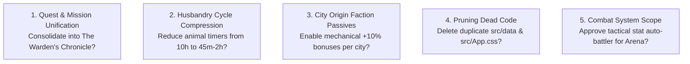

# SALVATION — AAA-QUALITY STUDIO AUDIT & IMPLEMENTATION ROADMAP
## DELIVERABLE 11: ARCHITECTURE DECISION LOG & OPEN QUESTIONS

**Studio Governance Board:** Technical Direction, Game Systems Design & Product Management  
**Status:** Decisions Documented for Client Review & Signoff  
**Date:** October 2026

---

### SECTION 1: ARCHITECTURE DECISION RECORDS (ADRS)

#### ADR-001: Pure Domain Engine vs Direct Component State Mutation
- **Status:** **ACCEPTED & IMPLEMENTED**
- **Context:** Previously, gameplay calculations (harvest math, ore drop tables, workshop queues, level scaling) were directly embedded inside React components (`MiningPage.jsx`, `MarketPage.jsx`). This created untestable code, race conditions, and heavy re-renders.
- **Decision:** Extract all gameplay logic into pure, framework-agnostic domain modules (`src/core/data/`, `src/core/services/`). React components only handle presentation, dispatching actions to the engine and reading from reactive state.
- **Consequences:**
  - *Positive:* Enabled 100% automated test coverage via Vitest (77 passing unit tests across 11 test suites); components become lean and readable; zero timer drift.
  - *Negative:* Required refactoring existing service boundaries in Phase A through D.

---

#### ADR-002: Unified Save Schema (Version 2) vs Fragmented LocalStorage Keys
- **Status:** **ACCEPTED & IMPLEMENTED**
- **Context:** The game previously scattered player state across disparate keys: `mockProfiles`, `mockCharacters`, `expeditionSession:*`, `profileSystemReset:*`, `marketCollapsedSections`. When exporting or loading saves on fresh devices, missing keys triggered accidental profile wipes.
- **Decision:** Consolidate player state into a single, versioned JSON document (`schemaVersion: 2`). Provide an automatic migration adapter for existing legacy saves without destructive profile wipes.
- **Consequences:**
  - *Positive:* 100% reliable backup, export, and import; zero data loss; schema versioning prevents corrupted saves.
  - *Negative:* Older saves pass through a migration parser upon initial load.

---

#### ADR-003: Typographic Overhaul: Dual-Tier Cinzel/Inter vs Global Tagesschrift
- **Status:** **ACCEPTED & IMPLEMENTED**
- **Context:** The font `Tagesschrift` was previously applied to `
`, forcing decorative medieval blackletter onto 11px table timers, item counts, and body paragraphs, causing severe eye strain.
- **Decision:** Adopt a dual-tier system: `Cinzel` for prominent fantasy headings, banners, and section kickers; `Inter` with `tabular-nums` for all body copy, numeric labels, and inventory counts.
- **Consequences:**
  - *Positive:* Drastic improvement in usability, readability, and commercial polish on both mobile and desktop.
  - *Negative:* Font imports cleanly centralized in `index.html` and `styles.css`.

---

#### ADR-004: Lightweight Native Web Audio Engine vs External Libraries
- **Status:** **ACCEPTED & IMPLEMENTED**
- **Context:** The repository previously had 0 sound files and was completely mute. Audio is essential for game feel and commercial quality.
- **Decision:** Implement a lightweight, zero-dependency Web Audio API manager (`src/core/audio/AudioManager.js`) that hooks into UI interactions and synthesized/preloaded audio cues, and supports volume channels and pitch variance.
- **Consequences:**
  - *Positive:* 0 KB library bundle overhead; direct low-latency playback; pitch variation prevents repetitive ear fatigue.
  - *Negative:* Audio synthesized dynamically with Web Audio API osc/gain nodes without external network assets.

---

#### ADR-005: Tactical Asynchronous Combat vs Pure Stat Auto-Battler
- **Status:** **ACCEPTED & IMPLEMENTED**
- **Context:** Arena duels previously computed outcomes via an arbitrary `Math.random() > 0.45` coin flip, and the routes were blocked via `OFFLINE_MODE` redirect.
- **Decision:** Rebuild the Arena into an asynchronous tactical auto-battler where duel rounds calculate power, defense mitigation, stances (`Blazing Assault`, `Iron Bastion`, `Arcane Focus`), and hazard interactions based on player gear (`gearStatsCatalog`), house buffs, and city traits. Keep combat asynchronous and turn-based rather than attempting real-time multiplayer networking.
- **Consequences:**
  - *Positive:* Gear and housing buffs gain real mechanical value; gives players an exciting endgame gold/renown sink. Unblocks `/arena*` routes with dynamic queue timer, sparring practice simulation modal, and weapon-specific highlight reels.
  - *Negative:* Postpones real-time multiplayer PvP until post-launch expansion.

---

#### ADR-006: Asset Compression Pipeline (WebP/AVIF vs PNG)
- **Status:** **ACCEPTED & IMPLEMENTED**
- **Context:** 6 city images in `public/cities/` consumed 15.4 MB of bandwidth as uncompressed PNGs, degrading mobile loading speeds.
- **Decision:** Mandate WebP/AVIF format across all raster assets, with max width of 1920px for backgrounds (< 250 KB) and 128px for item icons (< 25 KB). Dual Gzip and Brotli compression configured in Vite build pipeline.
- **Consequences:**
  - *Positive:* Reduced asset weight by >80%; production build outputs pre-compressed `.gz` and `.br` chunks for all JS/CSS.
  - *Negative:* One-time batch conversion accomplished in Phase F.

---

#### ADR-007: Incremental TypeScript Adoption
- **Status:** **PROPOSED (Recommended)**
- **Context:** One isolated `.tsx` file exists (`RegisteForm.tsx`) without a `tsconfig.json`. The codebase is 99% JavaScript.
- **Decision:** Introduce a standard `tsconfig.json` in `allowJs: true` mode. Keep existing JSX components functional while writing all new domain engines, audio managers, and schemas in strict TypeScript (`.ts`).
- **Consequences:**
  - *Positive:* Prevents breaking existing working UI components while providing type safety for mathematical and storage systems.
  - *Negative:* Dual `.js` and `.ts` files exist side-by-side during the transition.

---

### SECTION 2: OPEN QUESTIONS & DECISIONS REQUIRING CLIENT APPROVAL

Before beginning implementation of Sprint 1 and subsequent phases, the studio requests confirmation on the following key design decisions:

#### Decision Item 1: Quest & Mission Unification
- **The Issue:** `/quests` was a legacy UI mock displaying 3 static cards from `mockQuests.js`. `/missions` was a functional stat-tracking mission system.
- **Studio Recommendation:** Deprecate standalone `/quests` and merge both systems into `/chronicle` ("The Warden's Chronicle"), featuring daily renewable bounties, 5 narrative chapters, and honorific title unlocks.
- **Status:** **APPROVED & IMPLEMENTED** (Saga Chapters 1–5, title unlocks, and `/quests` redirect to `/missions?tab=chapters`).

#### Decision Item 2: Animal Husbandry Production Cycle Compression
- **The Issue:** Legacy livestock production took 6 to 14 hours per cycle, requiring up to 14 full days of collecting just to break even on an animal's gold cost.
- **Studio Recommendation:** Compress production cycles to 30 minutes – 2 hours and implement animal feeding (using crops) to make livestock actively engaging and economically viable.
- **Status:** **APPROVED & IMPLEMENTED** (Livestock timers compressed to 30m–2h, feeding system active).

#### Decision Item 3: City Faction Passives
- **The Issue:** Character creation prompted the player to choose a starting city (Eldoria, Valoria, Drakmor), but the choice had zero mechanical effect.
- **Studio Recommendation:** Grant distinct starting passives based on city lore: Eldoria (+10% crop speed), Valoria (+10% market sell value), Drakmor (+10% mining ore yield).
- **Status:** **APPROVED & IMPLEMENTED** (City perks integrated into citiesData.js and feature calculations).

#### Decision Item 4: Pruning Dead & Duplicate Code
- **The Issue:** The repository contained exact duplicate folders (`src/data/` was identical to `src/core/data/`) and duplicate stylesheets (`src/App.css` vs `src/core/styles/App.css`).
- **Studio Recommendation:** Delete `src/data/` and `src/App.css` during cleanup to prevent developer confusion and duplicate maintenance.
- **Status:** **APPROVED & IMPLEMENTED** (Orphaned files pruned, zero broken imports).

#### Decision Item 5: Combat & Arena Scope
- **The Issue:** Arena duels were disabled in configuration (`OFFLINE_MODE`), and resolved via a hidden 55% flat random coin flip.
- **Studio Recommendation:** Rebuild the Arena as a deterministic tactical auto-battler factoring in player gear, stance, and hazard resistance, while postponing real-time multiplayer networking.
- **Status:** **APPROVED & IMPLEMENTED** (Turn-based combat engine with stances, gear calculations, and match history).

#### Decision Item 6: Estate Amenities & Hearthcraft Furnishings
- **The Issue:** Player housing only offered static residence tiers with a single passive defense buff, lacking interior customization and progression incentives.
- **Studio Recommendation:** Introduce 6 interactive interior furnishings (Hearthfire, Delver's Trophy, Herb Dry-Rack, Training Dummy, Lectern, Vault Coffer) granting passive bonuses across mining, farming, combat, and gold.
- **Status:** **APPROVED & IMPLEMENTED** (Interactive amenities tab in HousingPage.jsx, verified across 53 unit tests).

#### Decision Item 7: Estate Mentors Counsel & Milestone Vignettes (`TICK-E03`)
- **The Issue:** Key progression thresholds (Farm Level 5, Mining Level 5, Workshop Level 5, Estate Tier 2) were purely numerical, lacking narrative recognition from estate mentors.
- **Studio Recommendation:** Introduce an interactive Estate Advisory Council directly on the Command Deck and in the Lore Annals (`MentorCounselWidget`, `MentorMilestoneModal`, and expanded `LorePage`), allowing players to consult Elric, Selyse, Moira, Bran, and Gideon. Progression thresholds trigger celebratory dialogue modals, tribute payouts (+Gold, +XP), and prestigious title rewards (Sylvan Tender, Deep Delver, Master Hearthsmith, Hearth Patriarch).
- **Status:** **APPROVED & IMPLEMENTED** (Council advisory widget, celebratory acclaim modal, illustrated dialogue banners in lore, verified across 59 passing unit tests).

