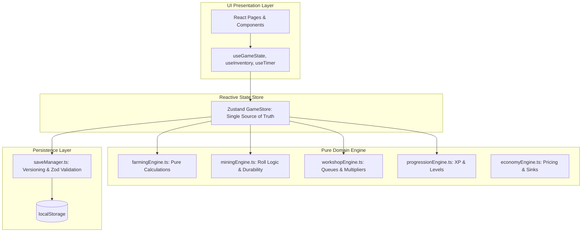
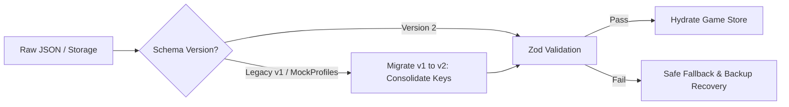

# SALVATION — AAA-QUALITY STUDIO AUDIT & IMPLEMENTATION ROADMAP
## DELIVERABLE 07: ENGINEERING, PERSISTENCE & PERFORMANCE PLAN

**Studio Disciplines:** Principal Game Architect, Lead Frontend Performance Engineer & QA Lead  
**Tech Stack Baseline:** React 19, Vite 6, Tailwind CSS v4, React Router 7

---

### 1. STACK & DEPENDENCY EVALUATION

The repository runs on a modern foundational stack (React 19.0.0, Vite 6.4.1, Tailwind 4.1.5), which provides outstanding potential. However, architectural debt and improper build configurations currently undermine this foundation.

| Library / Tool | Current Status | Evaluation & Diagnosis | Studio Recommendation |
|---|---|---|---|
| **React 19** | `^19.0.0` (Active) | Good foundation. However, components rely on legacy patterns (`setInterval` driving state every 1000ms–3000ms, giant monolithic files with 20+ hooks). | **RETAIN & LEVERAGE:** Utilize React 19 `useTransition` and `useDeferredValue` for non-blocking UI filtering in the Market and Inventory. |
| **Vite 6** | `^6.4.1` (Active) | Excellent build speeds (~2.9s build time). | **RETAIN:** Update configuration to fix `vite-plugin-compression` Windows drive-path bugs and resolve missing assets. |
| **Tailwind CSS v4** | `^4.1.5` (Active) | Tailwind v4 uses `@theme` in CSS. Currently, `@import "tailwindcss";` is called in both `index.css` and `App.css`, bloating the output CSS to 183.6 KB. | **OPTIMIZE:** Consolidate Tailwind imports into a single entry point (`index.css`), move design tokens into `@theme`, and delete duplicate stylesheets. |
| **Zustand** | *Not Installed* | Current state relies on raw singleton classes mutating `localStorage` directly inside component callbacks, causing UI synchronization race conditions. | **ADOPT (Phase A):** Install Zustand (1.2 KB gzipped). Provides a reactive, centralized game state store with zero React Context re-render cascades. |
| **Zod** | `node_modules` (Transitive) | Save files and imported JSON have no runtime validation. Corrupted saves crash the entire application on startup. | **ADOPT (Phase A):** Define explicit Zod runtime schemas for player saves, ensuring safe migrations and error handling. |
| **Vitest & RTL** | *Not Installed* | Zero test files exist in `src/`. No automated verification of farming timers, mining yield math, or inventory delta safety. | **ADOPT (Phase A):** Install Vitest and React Testing Library. Vitest shares Vite’s configuration with instant execution. |
| **TypeScript** | Partial (`RegisteForm.tsx`) | One isolated `.tsx` file exists without a `tsconfig.json`. Codebase is 99% JavaScript with loose object shapes. | **INCREMENTAL ADOPTION:** Introduce `tsconfig.json` in allowJs mode. Write all new domain engine models in TypeScript (`.ts`), leaving existing JSX functional. |

---

### 2. DOMAIN-DRIVEN GAME ENGINE ARCHITECTURE

Currently, game mechanics (timers, harvest calculations, XP scaling, crafting logic) are mixed directly inside giant React UI components (`MiningPage.jsx` is 1,237 lines; `MarketPage.jsx` is 538 lines). This makes gameplay rules impossible to test in isolation, creates memory leaks via abandoned intervals, and causes severe re-render cascades.

#### Proposed Decoupled Engine Architecture



#### Core Architectural Principle: Pure Domain Functions
All game mechanics must be implemented as deterministic, pure functions taking inputs and returning immutable deltas:
```typescript
// Example: Pure Farming Domain Function
export interface HarvestResult {
  nextPlot: PlotState;
  itemsProduced: Record<string, number>;
  xpEarned: number;
  didLevelUp: boolean;
  nextFarmLevel: number;
  nextFarmXp: number;
}

export function harvestPlot(
  plot: PlotState,
  crop: CropDefinition,
  weather: WeatherCondition,
  farmLevel: number,
  farmXp: number,
  now: number
): HarvestResult {
  if (!plot.cropId || !plot.harvestAt || now < plot.harvestAt) {
    throw new Error('Crop is not ready for harvest');
  }

  const yieldAmount = Math.max(1, Math.round(crop.yieldAmount * weather.yieldMultiplier));
  const xpGain = Math.max(5, yieldAmount * 8);
  const { nextLevel, nextXp, didLevelUp } = calculateLevelProgression(farmLevel, farmXp + xpGain);

  return {
    nextPlot: { id: plot.id, cropId: null, plantedAt: null, harvestAt: null },
    itemsProduced: { [crop.yieldId]: yieldAmount },
    xpEarned: xpGain,
    didLevelUp,
    nextFarmLevel: nextLevel,
    nextFarmXp: nextXp,
  };
}
```

---

### 3. TIME-BASED SYSTEMS & OFFLINE PROGRESSION

#### Eliminating Timer Drift & Interval Lag
The current code runs multiple independent `setInterval(..., 1000)` and `setInterval(..., 3000)` hooks in almost every page component. When the player tabs away or minimizes the browser, modern browsers throttle JavaScript intervals to 1 execution per minute (or suspend execution completely), causing timer desynchronization and jitter.

#### Real-Time Timestamp Delta Engine
1. **Never Tick Forward by 1 Second in State:** Timers must never store `remainingSeconds: 60` and subtract 1 on an interval.
2. **Absolute Timestamps Only:** Store absolute completion timestamps (`finishAt: 1714500000000`).
3. **Offline Progression Catch-Up:** When the player returns to the game (via `document.addEventListener('visibilitychange')` or window focus), the engine computes `delta = Date.now() - lastActiveTimestamp`:
   - Checks all plots where `harvestAt <= Date.now()`.
   - Processes passive mining hireling ticks: `ticks = Math.floor(delta / 3600000) * hirelingRate`.
   - Processes completed workshop queues.
   - Accrues animal products up to maximum storage capacity.
   - Pops a clean "Welcome Back, Warden" summary modal detailing offline yields.

---

### 4. SAVE DATA SCHEMA, VERSIONING & MIGRATION PIPELINE

#### The Versioned Save Schema
To permanently prevent the profile wipe bug identified in `CharacterService.jsx`, all game data must be consolidated into a single unified JSON document validated by Zod.

```typescript
// src/core/storage/saveSchema.ts
import { z } from 'zod';

export const SaveDataSchema = z.object({
  schemaVersion: z.literal(2),
  exportedAt: z.string().datetime(),
  character: z.object({
    name: z.string().min(2).max(24),
    race: z.string(),
    className: z.string(),
    city: z.string(),
    avatarUrl: z.string(),
    bio: z.string().default(''),
  }),
  stats: z.object({
    level: z.number().int().min(1),
    xp: z.number().int().min(0),
    gold: z.number().int().min(0),
    renown: z.number().int().min(0),
    expeditionsCompleted: z.number().int().min(0),
  }),
  farming: z.object({
    farmLevel: z.number().int().min(1),
    farmXp: z.number().int().min(0),
    landSize: z.number().int().min(3),
    plots: z.array(z.object({
      id: z.number(),
      cropId: z.string().nullable(),
      plantedAt: z.number().nullable(),
      harvestAt: z.number().nullable(),
    })),
    animals: z.record(z.object({
      count: z.number().int().min(0),
      lastCollectedAt: z.number(),
    })),
  }),
  mining: z.object({
    miningLevel: z.number().int().min(1),
    miningXp: z.number().int().min(0),
    pickaxeLevel: z.number().int().min(1),
    forgeLevel: z.number().int().min(1),
    prestigeLevel: z.number().int().min(0),
    session: z.object({
      startAt: z.number(),
      endAt: z.number(),
      accruedXp: z.number(),
    }).nullable(),
  }),
  workshop: z.object({
    level: z.number().int().min(1),
    xp: z.number().int().min(0),
    upgradeLevel: z.number().int().min(1),
    queue: z.array(z.object({
      id: z.string(),
      recipeId: z.string(),
      quantity: z.number().int().min(1),
      startAt: z.number(),
      finishAt: z.number(),
    })),
  }),
  expedition: z.object({
    locationId: z.string(),
    startTime: z.number(),
    endTime: z.number(),
  }).nullable(),
  inventory: z.record(z.number().int().min(0)),
});

export type SaveData = z.infer<typeof SaveDataSchema>;
```

#### Automated Migration Pipeline
When loading data from `localStorage` or an exported file:


---

### 5. PERFORMANCE OPTIMIZATION & BENCHMARKING

#### 1. Asset Optimization (15.4 MB Elimination)
The 6 PNG images in `public/cities/` account for 15.4 MB of bandwidth.
- **Action:** Convert `ValoriaCity.png` (3.1 MB), `EldoriaCity.png` (2.8 MB), `DarkmorCity.png` (2.5 MB), etc., to modern **WebP** at 85% quality with a max width of 1920px.
- **Target:** Total size of the cities directory drops from **15.4 MB to under 1.2 MB** (a 92% bandwidth reduction).

#### 2. Build Fixes & Bundle Pruning
- **Fix `vite-plugin-compression` on Windows:** Rollup chunk paths on Windows contain drive letters (`dist/C:/...`). Update the plugin options with a normalized destination path or replace with standard `rollup-plugin-brotli`.
- **Eliminate Duplicate Tailwind Import:** Remove `@import "tailwindcss";` from `src/core/styles/App.css`, leaving it solely in `index.css`.
- **Fix Missing Link in `index.html`:** Remove `<link href="/src/styles.css" rel="stylesheet" />` and replace CDN SweetAlert with local `react-hot-toast` or native dialogs.

#### 3. Measurable Acceptance Criteria & Performance Budgets

| Metric | Current State | Target Release Budget | Verification Tool |
|---|---|---|---|
| **Lighthouse Performance Score** | ~68 / 100 (Uncompressed images) | **≥ 95 / 100** | Chrome DevTools Lighthouse (Desktop & Mobile) |
| **First Contentful Paint (FCP)** | 1.8s | **< 0.8s** | Web Vitals / Speed Insights |
| **Largest Contentful Paint (LCP)** | 3.4s (3MB city PNGs) | **< 1.5s** | Web Vitals |
| **Total Blocking Time (TBT)** | 140ms | **< 50ms** | Chrome DevTools Performance Profiler |
| **Initial Bundle JS (gzipped)** | 92 KB | **< 110 KB** (including new audio/store) | Rollup Visualizer (`dist/stats.html`) |
| **Initial CSS (gzipped)** | 28.7 KB | **< 16 KB** | Vite Build Output |
| **Runtime Frame Rate** | Drops during multi-plot ticks | **Consistent 60 FPS** | Chrome FPS Meter |
| **Memory Leak Stability** | Timers create orphan callbacks | **0 unbounded closures** | Chrome Memory Heap Snapshot over 30 min |

---

### 6. QA TESTING STRATEGY

#### 1. Vitest Unit & Domain Test Suite
Automated test specs covering all pure domain functions:
- `farmingEngine.test.ts`: Verify crop growth durations, season multipliers, plot expansion costs, and leveling thresholds.
- `husbandryEngine.test.ts`: Verify cycle calculations, feed multiplier application, and product grants.
- `miningEngine.test.ts`: Verify node durability reductions, ore tier drop tables, forge upgrade bonuses, and `rollMiningTick` parameter safety.
- `inventoryService.test.ts`: Verify `applyInventoryDelta`, `canAffordItems`, and negative quantity protection.
- `saveMigration.test.ts`: Test parsing legacy v1 mock profiles into strict v2 Zod schemas without data loss.

#### 2. Playwright End-to-End Test Journeys
Automate the 5 most critical player journeys:
1. **New Player Onboarding:** Start fresh save -> Choose City -> Choose Race -> Choose Class -> Enter Dashboard -> Verify Starter Cottage.
2. **Agricultural Cycle:** Purchase Turnip Seeds -> Plant on Plot 1 -> Advance Clock / Wait -> Harvest Crop -> Verify Turnips in Vault & Gold gained.
3. **Active Mining Shatter:** Spawn Ore Node -> Click node until durability reaches 0 -> Verify Ore items awarded to Vault & Mining XP incremented.
4. **Artisan Crafting:** Smelt Iron Ore into Bar -> Verify Queue timer -> Claim Bar -> Verify Vault balance.
5. **Save Persistence & Reload:** Export Save JSON -> Clear Browser LocalStorage -> Import Save JSON -> Verify 100% state restoration with zero level-reset anomalies.
