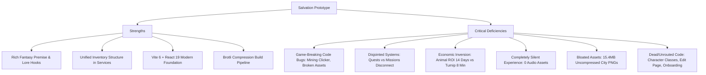

# SALVATION — AAA-QUALITY STUDIO AUDIT & IMPLEMENTATION ROADMAP
## DELIVERABLE 01: EXECUTIVE SUMMARY & STRATEGIC ASSESSMENT

**Studio Evaluation Board:** Creative Direction, Game Design, Systems Engineering, Technical Art, Narrative, QA & Production  
**Game Title:** Salvation  
**Target Genre:** Cozy Dark-Fantasy Estate Management, Agricultural Simulation & Dungeon Exploration  
**Tech Stack:** React 19, Vite 6, Tailwind CSS v4, React Router 7  
**Date of Audit:** October 2026  
**Audit Scope:** Full codebase reconnaissance, runtime build analysis, gameplay systems balance, technical performance, and commercially credible roadmap.

---

### 1. EXECUTIVE ASSESSMENT & STUDIO DIAGNOSIS

Salvation possesses a compelling conceptual core: an atmospheric fusion of cozy resource management (farming, animal husbandry, workshop processing) with dark-fantasy gothic progression (sunken mines, lost expeditions, ancestral houses, and ancient oaths). The premise bridges the satisfying feedback loops of games like *Stardew Valley* and *Graveyard Keeper* with the mood and tone of *Darkest Dungeon* or *Sunless Skies*.

However, our senior studio audit confirms that **the current repository is an early-stage, fragmented prototype with critical architectural flaws, game-breaking mathematical disconnects, and unfinished visual scaffolding.** While a casual glance reveals an attractive dark-and-gold color palette and numerous feature files, inspecting the actual code uncovers an experience held together by disjointed mock data, dead buttons, broken formulas, and non-functional routes.

#### Commercial Gap Analysis
- **Current Maturity:** Grade **D+** (Functional early prototype with several completely broken sub-systems).
- **Target Commercial Quality:** Grade **A- / AAA-Indie** (Cohesive, polished, rich audiovisual feedback, balanced multi-tiered economy, rock-solid persistence, and 50+ hours of engaging progression).
- **Estimated Development Distance:** Approximately **10 to 12 weeks of focused studio-grade development** across 6 structured phases.

---

### 2. THE TEN MOST CRITICAL AUDIT FINDINGS

| # | System | Severity | Verified Code Fact | Player Experience Impact |
|---|--------|----------|--------------------|--------------------------|
| **1** | **Mining Clicker Minigame** | **P0 Blocker** | `rollMiningTick(miningLevel, clickEfficiency)` in `MiningClickPage.jsx` passes positional numbers to a function expecting an options object; `hitResult.reward` is undefined; `addItems` return value is discarded. | The active mining minigame awards 0 XP and 0 items on node shatter. All clicks and node destructions are completely wasted. |
| **2** | **Broken Asset References** | **P0 Blocker** | `miningData.js` pickaxe upgrades reference `/pickaxe/mythril.webp`, `/pickaxe/voidsteel.webp`, and `/pickaxe/starforge.webp`, but files on disk are named `mythril_pickaxe.webp`, etc. | Pickaxes tier 5, 6, and 7 render broken image icons in the equipment interface. |
| **3** | **Broken Stylesheet Link & Build Warnings** | **P1 Defect** | `index.html` links `<link href="/src/styles.css" />` which does not exist (`src/core/styles/styles.css` is used). Tailwind is imported twice (`index.css` and `App.css`). | Build emits 4 warnings; duplicate CSS bloats the initial stylesheet to 183.6 KB (gzipped 28.7 KB). |
| **4** | **Completely Mute Audio Landscape** | **P1 Quality** | The repository contains exactly 0 audio files (`.mp3`, `.ogg`, `.wav`). `InteractionFeedbackLayer.jsx` dispatches `ui:sfx` events, but zero listeners exist. | Complete sensory disconnection. Actions feel flat, wooden, and lifeless with no auditory confirmation or musical atmosphere. |
| **5** | **Animal Husbandry Economic Inversion** | **P1 Balance** | Chickens cost 600g and produce 2 eggs (38g) every 6 hours (ROI: 94.7 hours). Cows take 290 hours (~12 days) to break even. Conversely, 1 Turnip plot yields 30g net in 8 minutes. | Players who invest in animals feel severely penalized. Farming crops completely dominates the economy while animals are economically useless. |
| **6** | **Disjointed Quests vs Missions** | **P1 Design** | `/quests` renders 3 hardcoded static objects from `mockQuests.js` with dead buttons. `/missions` renders dynamic stat-based tasks from `missionData.js`. | Confusing, fragmented player UX. The "Quest Log" is a fake mockup, while real objectives are hidden under "Missions". |
| **7** | **Unrouted & Orphaned Systems** | **P1 Debt** | `SelectClass.jsx` exists but is omitted from `CreateCharacterPage.jsx`. `EditCharacterPage.jsx` is lazy-loaded in `App.jsx` but has no `<Route>`. `OnboardingGuide.jsx` and `NotificationService.jsx` are never imported. | Players cannot choose their character class during creation (it defaults to race mapping); character editing and onboarding are inaccessible dead code. |
| **8** | **Massive Asset Payload Bloat** | **P2 Performance** | 6 starting city images in `public/cities/` total 15.4 MB of uncompressed PNGs (`ValoriaCity.png` is 3.1 MB alone). | Excessive bandwidth consumption, sluggish initial load on standard mobile/broadband connections, layout popping. |
| **9** | **Profile Reset & Storage Inconsistency** | **P1 Reliability** | `CharacterService.jsx` executes a reset check on every load if `profileSystemReset:${username}` is absent. `LoadSavePage.jsx` omits `expeditionSession` and reset flags during export. | Imported saves on a new device or cleared cache trigger an automatic reset of player stats and levels back to level 1 defaults. |
| **10** | **Combat System Coin Flip** | **P1 Gameplay** | `arenaOpponents.js` line 311 computes duel outcomes via `Math.random() > 0.45`. Player power, gear, stats, and hazards are purely cosmetic. Routes are blocked via `OFFLINE_MODE` redirect. | Zero tactical gameplay. Combat is a hidden 55% flat coin flip that is currently disabled in configuration to mask its incompleteness. |

---

### 3. THE 10 EXECUTIVE DECISION MEMO ANSWERS

#### 1. What are the ten most important improvements?
1. **Fix Core Defects & Broken Code:** Repair the `MiningClickPage` loot dispatch and XP calculation, correct pickaxe asset file paths, and fix `index.html` link tags.
2. **Implement Interactive Audio Engine:** Build a lightweight Web Audio / procedural sound manager reacting to `ui:sfx` with tactile harvest pops, ore clinks, anvil strikes, and gold chimes.
3. **Rebalance the Core Economic Loops:** Bring animal husbandry ROI down to competitive levels (12-18 hours break-even), smooth crop margins, and eliminate trivial market arbitrage.
4. **Unify Quests & Progression:** Merge `/quests` and `/missions` into an integrated, narrative-driven Chronicle system that tracks farm, mine, craft, and expedition milestones.
5. **Establish High-Legibility Visual Identity:** Remove global `Tagesschrift` text from body fonts; establish a dual-tier typographic system (Gothic Display + Crisp Modern Sans Serif) with distinct surface hierarchy.
6. **Integrate Real Character Customization:** Add the missing Class Selection step into character creation and route the Character Edit interface with proper in-game gold costs.
7. **Optimize Assets & Eliminate 15MB Bloat:** Convert all city and environment PNGs to compressed WebP/AVIF with responsive srcset, slashing the public directory by over 80%.
8. **Rebuild Combat into a Tactical Auto-Battler:** Replace `Math.random() > 0.45` with deterministic turn-based stat checks that factor in gear, house buffs, race abilities, and hazard counters.
9. **Architect Pure Domain Game Logic:** Decouple economy and timer math from React components into pure, testable domain modules (`/src/engine/`).
10. **Harden Save Persistence & Migration:** Ensure export payloads include all active sessions and state flags, with schema versioning to prevent data corruption.

#### 2. What currently makes Salvation feel less professional than a polished commercial game?
- **Sensory Vacuum:** Total silence. A game without interactive sound and ambient audio immediately signals "amateur tech demo" to players.
- **Unfinished Scaffolding:** Dead buttons (like "Continue Quest" on `QuestDetailPage`), mock text contradicting actual numbers (e.g., "Unlock animals at level 15" when chickens unlock at level 4), and hardcoded timer strings ("04:28" in Arena).
- **Inconsistent UI Typography & Spacing:** Global application of an unoptimized gothic display font across small body labels, coupled with generic Tailwind dark-mode borders and gradients that look like a SaaS dashboard rather than a fantasy estate.
- **Economic Incoherence:** Crops out-earn livestock by 1,000%, and daily task turn-ins pay less than selling the same goods directly on the open market.

#### 3. Which three improvements would deliver the greatest visible impact?
1. **Redesigned HUD & Surface Framing:** Replacing flat `gray-900` containers with rich gothic parchment/slate panels, ornate brass borders, and distinct visual states for empty, growing, and harvest-ready plots.
2. **Tactile Interaction & Reward FX:** Floating harvest numbers, glowing crop ready-states, animated pickaxe swings on nodes, and satisfying level-up celebratory modal banners.
3. **Optimized Visual Assets & Character Presentation:** Correcting high-tier tool sprites, displaying actual equipped gear icons instead of `noimage.webp`, and showcasing city backdrops without 3MB asset lag.

#### 4. Which three improvements would most improve player retention through genuine gameplay quality?
1. **Meaningful Interlocking Production Chains:** Requiring farm crops + animal goods + smelted ores to craft high-value workshop relics and expedition provisions.
2. **Unified Narrative Chronicle (Quests):** Giving players clear short-term (daily bounties), medium-term (house renovations & mine deep dives), and long-term (Sunforge reconstruction) goals with worthwhile narrative milestones.
3. **Deepened Mining & Discovery:** Transforming mining from a passive countdown into a multi-zone exploration with rare geode cracks, cavern discoveries, and pickaxe synergy.

#### 5. Which technical problems must be fixed before expanding the game?
- The **broken `MiningClickPage` method signatures and loot dispatch**.
- The **destructive profile reset logic** in `CharacterService.jsx`.
- The **incomplete save/load payload** that drops active sessions on export.
- The **duplicate Tailwind CSS compilation** and missing stylesheet link in `index.html`.
- The **unmounted 3-second interval full-page re-renders** across major feature pages.

#### 6. Which modern technologies should be adopted, and which should be avoided?
- **Adopt:**
  - **Vitest & React Testing Library:** Critical for testing progression math, timer algorithms, and inventory transactions without browser overhead.
  - **Zustand or Lightweight Engine Store:** Decouples complex multi-system state from giant 1,200-line React components.
  - **Howler.js or Native Web Audio Engine:** Lightweight, battle-tested audio playback with spatial layering and master volume controls.
  - **Zod:** Runtime schema validation for save files and imported player JSON.
- **Avoid:**
  - Heavy 3D libraries (Three.js / Babylon.js) — completely unnecessary for an isometric/2D management game.
  - Full Redux Toolkit — excessive boilerplate for a client-side game.
  - Premature multiplayer WebSockets / backend servers — Salvation's strength is a focused, premium offline-first single-player experience.

#### 7. What should the first 7 days of implementation accomplish?
- Complete **Sprint 1 (P0 Stabilization)**:
  - Fix `MiningClickPage` calculations, loot dispatch, and XP hooks.
  - Resolve pickaxe image path mismatches.
  - Fix `index.html` link and eliminate duplicate Tailwind imports.
  - Fix the 3 ESLint errors so the repository lints with 0 errors.
  - Correct the save export schema to include expedition sessions and reset flags.
  - Integrate Class Selection into the Character Creation flow.

#### 8. What should the first 30 days accomplish?
- Establish **Phases B, C, and D**:
  - Deploy the complete typography and design system overhaul.
  - Integrate the Web Audio engine with full SFX for UI, farming, mining, and crafting.
  - Rebalance the economy: livestock profitability, workshop crafting margins, and crop tiers.
  - Unify Quests and Missions into the single "Warden's Chronicle".
  - Optimize all public assets (convert PNGs to WebP/AVIF).

#### 9. What does a realistic first polished release contain?
- A fully functional, bug-free core loop: Farm -> Husbandry -> Mine -> Workshop -> Market -> Expeditions.
- Complete audio landscape (15+ SFX cues, 2 ambient tracks).
- 5 agricultural tiers, 6 livestock breeds, 7 mining zones, 12 workshop crafts.
- Cohesive dark-fantasy lore bible with 20 narrative journal quests.
- Robust, versioned local save system with import/export capabilities.
- 60 FPS performance across desktop and mobile browsers.

#### 10. What features should explicitly be postponed?
- **Real-Time PvP Arena Duels:** Keep arena as a tactical turn-based asynchronous duel simulator until core management is world-class.
- **Multiplayer Guild Raids:** The current `GuildPage` is a visual mock; postpone online multiplayer networking until post-launch.
- **Complex Real-Time Weather Particle Simulators:** Avoid GPU-heavy canvas storm simulations that degrade mobile battery life; use tasteful CSS environmental mood lighting.

---

### 4. STUDIO AUDIT DELIVERABLE STRUCTURE

The complete studio audit comprises 11 interconnected engineering, design, and production specifications located in `docs/audit/`:

1. [`executive-summary.md`](file:///C:/Users/abdel/WorkSpace/projects/Salvation-rpg/docs/audit/executive-summary.md) — Strategic Assessment & Studio Roadmap Overview *(This Document)*
2. [`repository-and-architecture-audit.md`](file:///C:/Users/abdel/WorkSpace/projects/Salvation-rpg/docs/audit/repository-and-architecture-audit.md) — Verified Codebase Architecture, Feature Inventory & Defect Register
3. [`creative-direction-and-ui-ux.md`](file:///C:/Users/abdel/WorkSpace/projects/Salvation-rpg/docs/audit/creative-direction-and-ui-ux.md) — Visual Identity, Typography, Color Tokens & Screen-by-Screen Blueprint
4. [`gameplay-and-economy-audit.md`](file:///C:/Users/abdel/WorkSpace/projects/Salvation-rpg/docs/audit/gameplay-and-economy-audit.md) — Systems Loops, Progression Tuning, Economic Balance & Formula Fixes
5. [`narrative-and-worldbuilding.md`](file:///C:/Users/abdel/WorkSpace/projects/Salvation-rpg/docs/audit/narrative-and-worldbuilding.md) — World Lore, The Fall of the Sunforge, NPC Personas & Quest Bible
6. [`animation-and-audio-plan.md`](file:///C:/Users/abdel/WorkSpace/projects/Salvation-rpg/docs/audit/animation-and-audio-plan.md) — Motion Design Hierarchy, Timing Specs & Interactive Web Audio Architecture
7. [`engineering-and-performance-plan.md`](file:///C:/Users/abdel/WorkSpace/projects/Salvation-rpg/docs/audit/engineering-and-performance-plan.md) — Domain Architecture, Save Migrations, Performance Benchmarks & Testing Strategy
8. [`implementation-roadmap.md`](file:///C:/Users/abdel/WorkSpace/projects/Salvation-rpg/docs/audit/implementation-roadmap.md) — Dependency-Aware 6-Phase Execution Plan with Ticket Scoring (P0–P3)
9. [`asset-production-plan.md`](file:///C:/Users/abdel/WorkSpace/projects/Salvation-rpg/docs/audit/asset-production-plan.md) — Prioritized Visual & Audio Asset Matrix, AI Generation Pipeline & Specs
10. [`first-sprint-plan.md`](file:///C:/Users/abdel/WorkSpace/projects/Salvation-rpg/docs/audit/first-sprint-plan.md) — Actionable 2-Week Implementation Plan (Sprint 1: Stability & Foundation)
11. [`decision-log.md`](file:///C:/Users/abdel/WorkSpace/projects/Salvation-rpg/docs/audit/decision-log.md) — Architecture Decision Records (ADRs), Tradeoffs & Pending Approvals
