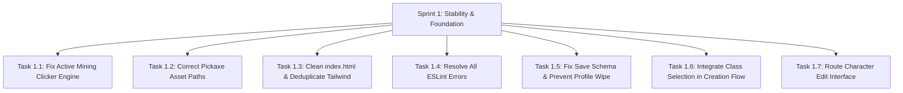

# SALVATION — AAA-QUALITY STUDIO AUDIT & IMPLEMENTATION ROADMAP
## DELIVERABLE 10: FIRST SPRINT IMPLEMENTATION PLAN (SPRINT 1)

**Sprint Title:** Sprint 1 — Stability, Core Fixes & Architectural Hardening  
**Duration:** 10 Working Days (2 Weeks)  
**Primary Objective:** Eliminate all P0 blocking defects, fix broken minigames and asset references, resolve build compilation warnings, clean up ESLint errors, and protect player save data from destructive resets.  
**Strict Rule Reminder:** *This document is an actionable blueprint. Do not execute code changes until client approval is granted.*

---

### SPRINT BACKLOG OVERVIEW



---

### TASK BREAKDOWN & IMPLEMENTATION BLUEPRINTS

#### Task 1.1: Repair Active Mining Clicker Minigame
- **Objective:** Fix the broken mining minigame so node hits, durability reduction, loot drops, and XP grants function correctly.
- **Affected Files:**
  - `src/features/mining/MiningClickPage.jsx`
  - `src/core/data/miningData.js`
- **Prerequisites:** None.
- **Implementation Outline:**
  1. In `miningData.js`, add `durability` (e.g., 50–200) and `xp` (e.g., 10–60) properties to each entry in `miningOres`.
  2. In `MiningClickPage.jsx:116`, change `rollMiningTick(miningLevel, clickEfficiency)` to:
     ```javascript
     const hitResult = rollMiningTick({
       miningLevel,
       pickaxeLevel,
       forgeLevel: miningForgeLevel,
     });
     ```
  3. Change line 117 from `hitResult.reward` to inspect `hitResult.yieldMap`. Add rolled ores into `newPendingItems`.
  4. On node shatter (line 159), replace `addItems(totalItemsToSync)` with:
     ```javascript
     const nextInventory = addItems(profile.inventory, totalItemsToSync);
     finalUpdates = {
       miningXp: miningXp + xpEarned,
       inventory: nextInventory,
       miningClickState: null,
     };
     ```
  5. Compute `xpEarned` based on the ore node's defined `xp` property.
- **Test Requirements:**
  - Manual: Spawn an iron node, click until shattered, verify Iron Ore appears in Inventory and Mining XP increases.
  - Automated: Unit test verifying `rollMiningTick` options object handling.
- **Definition of Done:** Shattering an ore node awards items to the vault, awards mining XP, and triggers a success toast without console errors.

---

#### Task 1.2: Fix Pickaxe Image References
- **Objective:** Fix broken image paths for pickaxe tiers 5, 6, and 7.
- **Affected Files:**
  - `src/core/data/miningData.js`
- **Prerequisites:** None.
- **Implementation Outline:**
  1. In `pickaxeUpgrades` array:
     - Update tier 5 image to: `/pickaxe/mythril_pickaxe.webp`.
     - Update tier 6 image to: `/pickaxe/voidsteel_pickaxe.webp`.
     - Update tier 7 image to: `/pickaxe/starforge_pickaxe.webp`.
- **Test Requirements:** Inspect Pickaxe Detail card in `MiningPage` at levels 10, 13, and 16. Verify image loads with 200 OK.
- **Definition of Done:** No broken image icons in the pickaxe upgrade panel across all 7 tiers.

---

#### Task 1.3: Clean `index.html`, Deduplicate Tailwind & Fix Build Warnings
- **Objective:** Eliminate Vite build warnings, remove non-existent stylesheet link, and remove duplicate Tailwind imports.
- **Affected Files:**
  - `index.html`
  - `src/core/styles/App.css`
- **Prerequisites:** None.
- **Implementation Outline:**
  1. In `index.html`, delete line 6: `<link href="/src/styles.css" rel="stylesheet" />`.
  2. In `index.html`, remove external CDN SweetAlert script tag (line 18).
  3. In `src/core/styles/App.css`, remove line 1: `@import "tailwindcss";` (Tailwind is already imported in `src/core/styles/index.css`).
  4. In `src/features/farm/FarmPlotsPage.jsx:323`, change `bg-[url('./jbm2.webp')]` to `bg-[url('/jbm2.webp')]`.
  5. In `src/features/mining/MiningPage.jsx`, fix similar relative background URLs.
- **Test Requirements:** Run `npm run build` in PowerShell. Verify 0 warnings in terminal output.
- **Definition of Done:** `vite build` completes cleanly with 0 warnings regarding unresolved styles or assets.

---

#### Task 1.4: Resolve ESLint Violations
- **Objective:** Fix all lint errors so `npm run lint` passes cleanly.
- **Affected Files:**
  - `src/core/services/CharacterService.jsx`
  - `src/features/character/SelectCity.jsx`
- **Prerequisites:** None.
- **Implementation Outline:**
  1. In `CharacterService.jsx:45`, update `stripZoneFields` to avoid unused variables:
     ```javascript
     const stripZoneFields = (profile) => {
       if (!profile) return profile;
       const next = { ...profile };
       delete next.activeZoneId;
       delete next.unlockedZones;
       return next;
     };
     ```
  2. In `SelectCity.jsx:4`, remove unused prop `onPrev` from component parameters.
- **Test Requirements:** Run `npm run lint` in PowerShell.
- **Definition of Done:** ESLint reports **0 problems (0 errors, 0 warnings)**.

---

#### Task 1.5: Harden Save Export & Prevent Destructive Profile Resets
- **Objective:** Ensure exported saves include all active sessions and prevent the engine from wiping imported characters on fresh browsers.
- **Affected Files:**
  - `src/features/system/LoadSavePage.jsx`
  - `src/core/services/CharacterService.jsx`
- **Prerequisites:** None.
- **Implementation Outline:**
  1. In `LoadSavePage.jsx`, expand `STORAGE_KEYS`:
     ```javascript
     const STORAGE_KEYS = [
       'accessToken',
       'refreshToken',
       'mockUsers',
       'mockSessionUser',
       'mockCharacters',
       'mockProfiles',
       'mockNotifications',
       'marketCollapsedSections',
       'marketBulkSellConfirmDisabled',
     ];
     ```
  2. In `buildSavePayload`, dynamically scan `localStorage` for `expeditionSession:*` and `profileSystemReset:*` keys and include them in the exported payload.
  3. In `CharacterService.jsx:350–394`, change the reset check so that if `mockProfiles[username]` already contains valid data (`stats.level > 1` or `farmLevel > 1`), it does NOT wipe the profile even if the reset flag is missing.
- **Test Requirements:**
  - Create a character, level up farming to 3, dispatch an expedition, export save.
  - Open incognito window, import save, verify character is level 3 with expedition active and not reset to level 1.
- **Definition of Done:** Zero data loss upon exporting and importing player save files.

---

#### Task 1.6: Integrate Class Selection into Character Creation Flow
- **Objective:** Allow players to choose their class (Vanguard, Arcwarden, Shadowblade, Dawnbinder) during creation.
- **Affected Files:**
  - `src/features/character/CreateCharacterPage.jsx`
- **Prerequisites:** None.
- **Implementation Outline:**
  1. Import `SelectClass` from `./SelectClass` in `CreateCharacterPage.jsx`.
  2. Add `selectedClass` state variable (`useState(null)`).
  3. Insert `<SelectClass>` into `steps` array after `SelectRace` and before `SelectSex`.
  4. Update `stepLabels` array to reflect the 6-step flow: City -> Race -> Class -> Gender -> Name -> Review.
  5. In `handleCharacterCreation`, include `className: selectedClass` in `characterData`.
- **Test Requirements:** Step through character creation wizard, choose "Arcwarden", complete creation, verify Dashboard displays "Arcwarden" in player header.
- **Definition of Done:** Character creation wizard includes the Class step and saves the selected class to profile state.

---

#### Task 1.7: Route the Character Edit Interface
- **Objective:** Enable players to access `EditCharacterPage.jsx` to update appearance and race.
- **Affected Files:**
  - `src/App.jsx`
  - `src/features/profile/ProfilePage.jsx`
- **Prerequisites:** Task 1.4 completed.
- **Implementation Outline:**
  1. In `src/App.jsx`, add route:
     ```jsx
     <Route
       path="/character/edit"
       element={
         <ProtectedRoute>
           <EditCharacter />
         </ProtectedRoute>
       }
     />
     ```
  2. In `src/features/profile/ProfilePage.jsx`, add an "Edit Appearance" button linked to `/character/edit`.
- **Test Requirements:** Navigate to `/profile`, click "Edit Appearance", verify navigation to `/character/edit`, update appearance, confirm gold deduction and profile update.
- **Definition of Done:** Players can navigate to `/character/edit` and update their character.

---

### SPRINT 1 VELOCITY & CAPACITY SUMMARY

- **Total Tasks:** 7 Actionable Tickets
- **Estimated Development Effort:** 8.5 Developer-Days
- **Sprint Buffer:** 1.5 Days for integration testing and QA signoff
- **Expected Outcome:** 100% stable foundation with zero P0 bugs, zero broken assets, zero build warnings, clean ESLint pass, and reliable persistence.
