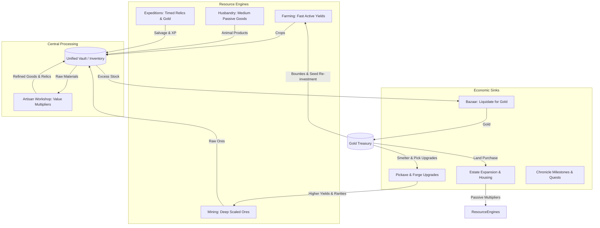
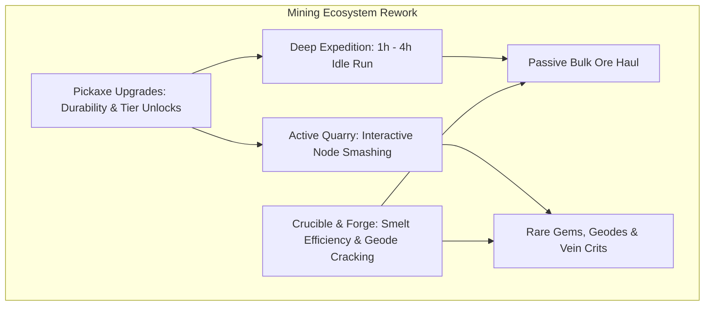

# SALVATION — AAA-QUALITY STUDIO AUDIT & IMPLEMENTATION ROADMAP
## DELIVERABLE 04: GAMEPLAY & ECONOMY AUDIT

**Studio Discipline:** Lead Systems Designer & Game Economy Balance Specialist  
**Focus Areas:** Resource Loops, Mathematical Tuning, Livestock Rework, Progression Pacing & Exploitation Prevention

---

### 1. MACRO-ECONOMIC FLOW MODEL

The foundation of Salvation is a closed-loop production economy with four primary resource engines feeding into a centralized vault, which then fuels estate expansion, gear upgrades, and long-term progression milestones.



---

### 2. FARMING SYSTEM AUDIT & TUNING

#### Current Crop Balance Audit
Below are the actual mathematical parameters defined in `src/core/data/farmData.js`:

| Crop | Level | Seed Cost | Grow Time | Base Yield | Sell Price | Gross Gold | Net Profit | Profit / Min |
|---|---|---|---|---|---|---|---|---|
| **Turnip** | 1 | 12g | 8 min (480s) | 3 | 14g | 42g | **+30g** | **3.75 g/min** |
| **Wheat** | 3 | 24g | 16 min (960s) | 4 | 22g | 88g | **+64g** | **4.00 g/min** |
| **Herb** | 6 | 50g | 25 min (1500s) | 4 | 38g | 152g | **+102g** | **4.08 g/min** |
| **Moonberry** | 10 | 135g | 50 min (3000s) | 5 | 52g | 260g | **+125g** | **2.50 g/min (DEFICIT)** |
| **Sunroot** | 14 | 210g | 70 min (4200s) | 6 | 75g | 450g | **+240g** | **3.43 g/min** |

#### Verified Flaws in Current Farming
1. **The Moonberry Economic Collapse:** Moonberry requires Farm Level 10 and a 50-minute commitment, yet yields only **2.50 gold/minute**, drastically worse than starter Turnips (3.75 g/min) and Level 6 Herbs (4.08 g/min). Players who unlock Moonberry are actively penalized for planting it.
2. **Task Turn-In Penalty:** Daily farm delivery tasks award **5 gold per crop delivered** (`farmTaskRewards.daily.goldPerItem = 5`). If a player delivers 4 turnips to a daily quest, they receive **20 gold**. If they sold those same 4 turnips directly on the market, they would receive **56 gold**. The quest system actively robs the player of gold.
3. **No Quality or Mutation Mechanics:** Harvests are strictly deterministic numbers. There is no joy of rolling a "Golden Turnip", "Giant Sunroot", or discovering wild cross-pollinated seeds.

#### Proposed Rebalanced Farming Table
Crops must adhere to the principle: *Longer timers demand higher total profit per plot to compensate for idle plot time, while shorter timers offer higher active yield per hour.*

| Crop | Level | Seed Cost | Grow Time | Yield | Sell Price | Net Profit | Profit / Min | Balance Intent |
|---|---|---|---|---|---|---|---|---|
| **Turnip** | 1 | 15g | 5 min | 3 | 12g | **+21g** | **4.20 g/min** | High-activity starter crop |
| **Wheat** | 3 | 30g | 12 min | 4 | 18g | **+42g** | **3.50 g/min** | Essential cooking staple |
| **Herb** | 6 | 60g | 25 min | 4 | 35g | **+80g** | **3.20 g/min** | High alchemy demand |
| **Moonberry** | 10 | 120g | 45 min | 5 | 55g | **+155g** | **3.44 g/min** | High-value luxury fruit |
| **Sunroot** | 14 | 200g | 90 min | 6 | 85g | **+310g** | **3.44 g/min** | Overnight / long idle crop |

---

### 3. ANIMAL HUSBANDRY AUDIT: THE BREAK-EVEN CRISIS

#### The Current Catastrophe
In `farmData.js`, livestock production is mathematically broken. The timers are set to real-world MMO timescales (6 to 14 hours), but product yields and prices are tuned to tiny pocket-change values.

| Animal | Buy Price | Sell Price | Production Cycle | Product | Yield | Sell Price | Gold / Cycle | Gold / Hour | Break-Even Time |
|---|---|---|---|---|---|---|---|---|---|
| **Chicken** | 600g | 360g | 6 hours | Egg | 2 | 19g | 38g | 6.33 g/hr | **94.7 hours (4.0 days)** |
| **Cow** | 1,200g | 720g | 8 hours | Milk | 1 | 33g | 33g | 4.13 g/hr | **290.9 hours (12.1 days)** |
| **Sheep** | 1,800g | 1,080g | 10 hours | Wool | 1 | 52g | 52g | 5.20 g/hr | **346.2 hours (14.4 days)** |
| **Goat** | 2,200g | 1,320g | 11 hours | Cheese | 2 | 62g | 124g | 11.27 g/hr | **195.2 hours (8.1 days)** |
| **Pig** | 2,600g | 1,560g | 14 hours | Truffle | 2 | 85g | 170g | 12.14 g/hr | **214.2 hours (8.9 days)** |
| **Beehive** | 3,000g | 1,800g | 7 hours | Honey | 1 | 72g | 72g | 10.28 g/hr | **291.6 hours (12.1 days)** |

#### The Verdict
A player spending 1,800 gold on a sheep must log in and collect wool on a rigid 10-hour schedule for **over two weeks straight** just to recoup their initial gold purchase! Meanwhile, a single 8-minute turnip plot makes 30 gold. In 8 hours, 3 turnip plots make **5,400 gold**—three times the cost of the sheep!

#### The Husbandry Redesign: Tactile Care & Shorter Cycles
Livestock should not be passive timers waiting for half a day. They should be active companions integrated into the farm ecosystem.
1. **Compressed Production Timers (45 min – 3 hours):** Chickens lay eggs every 45 minutes; cows produce milk every 90 minutes; sheep grow wool every 2 hours; pigs unearth truffles every 3 hours.
2. **The Feeding Mechanic (Farming Synergy):** Animals require Feed. Wheat and Turnips can be fed to livestock to boost their yield by +50% and accelerate their timers by 25%.
3. **Livestock Rebalanced Metrics:**

| Animal | Buy Price | Cycle Time | Base Product | Yield | Sell Value | Gold / Hour | Break-Even Time | Synergy Requirement |
|---|---|---|---|---|---|---|---|---|
| **Chickens** | 250g | 30 min | Fresh Egg | 2 | 15g | 60 g/hr | **4.1 hours** | Requires Grain Feed (Wheat) |
| **Cows** | 600g | 60 min | Milk Jug | 2 | 40g | 80 g/hr | **7.5 hours** | Requires Meadow Grass |
| **Sheep** | 1,000g | 90 min | Wool Fleece | 2 | 70g | 93 g/hr | **10.7 hours** | Feeds the Arcane Loom |
| **Pigs** | 1,600g | 120 min | Black Truffle | 2 | 120g | 120 g/hr | **13.3 hours** | Requires Root Forage |

---

### 4. MINING SYSTEMS AUDIT & REWORK

#### The Mining Duality: Passive Run vs Active Quarry
Salvation currently contains two mining implementations in `MiningPage.jsx` (42 KB) and `MiningClickPage.jsx` (10 KB):
- `MiningPage.jsx` runs a **5-hour passive session** that ticks once every minute (`MINING_TICK_MS = 60000`), rolling random ores based on pickaxe and forge level.
- `MiningClickPage.jsx` attempts to provide an **active clicker minigame**, but is completely non-functional due to method signature mismatches and missing properties.



#### Fixing the Active Mining Clicker
The active mining minigame in `MiningClickPage.jsx` must be rebuilt with verified models:
```javascript
// Current Defective Code (Lines 116-160):
const hitResult = rollMiningTick(miningLevel, clickEfficiency); // WRONG ARGUMENTS
const reward = hitResult.reward || null; // UNDEFINED PROPERTY
addItems(totalItemsToSync); // MISSING INVENTORY ARG, DISCARDED RETURN VALUE

// Corrected Engine Implementation:
const hitResult = rollMiningTick({
  miningLevel: profile.miningLevel,
  pickaxeLevel: profile.pickaxeLevel,
  forgeLevel: profile.miningForgeLevel,
});

if (hitResult.yieldMap) {
  // Correctly update pending items
  setPendingItems(prev => applyInventoryDelta(prev, hitResult.yieldMap));
}

// On Node Shatter:
const nextInventory = applyInventoryDelta(profile.inventory, totalEarnedItems);
CharacterService.updateMockProfile({
  inventory: nextInventory,
  miningXp: profile.miningXp + calculatedXp,
  miningClickState: null,
});
```

#### Ore Progression Tiers & Valuation
Ores must scale cleanly into the Workshop:
- **Tier 1 (Surface Quarry):** Iron (20g), Copper (25g), Bronze (32g)
- **Tier 2 (Deep Shaft):** Silver (55g), Electrum (70g)
- **Tier 3 (Subterranean Basin):** Gold (95g), Platinum (130g)
- **Tier 4 (Abyssal Rift):** Mythril (180g), Orichalcum (230g)
- **Tier 5 (Void Core):** Adamantite (300g), Voidsteel (380g)
- **Tier 6 (The Sunforge):** Starforge Ore (500g)

---

### 5. WORKSHOP CRAFTING AUDIT: VALUE-ADD MATRICES

#### The Market Arbitrage Vulnerability
In `MarketPage.jsx`, farm goods and ores can be purchased directly for `sellPrice * 1.3`. Because recipe input items are cheap on the market, players can execute an **infinite gold loop without farming or mining**:
1. Buy Turnips (18g each x 4 = 72g) and Milk (43g) from Market = 115g total.
2. Queue *Turnip Stew* in Kitchen.
3. Sell *Turnip Stew* back to Market for 175g.
4. Net free profit: **+60g per craft** with zero gameplay interaction.

#### Workshop Profit Rebalancing
The workshop must provide a legitimate **+20% to +35% value-add** over raw materials, but the open market must **not sell raw crafting ingredients at prices below recipe outputs**.

| Recipe | Workstation | Level | Craft Time | Input Materials (Market Value) | Output Item | Craft Sell Value | Net Crafting Margin |
|---|---|---|---|---|---|---|---|
| **Smelt Iron Bar** | Smelter | 1 | 10 min | 4 Iron Ore (80g) | 1 Iron Bar | **105g** | **+31.2% (+25g)** |
| **Cook Turnip Stew** | Kitchen | 2 | 12 min | 4 Turnips (48g) + 1 Milk (40g) = 88g | 1 Turnip Stew | **115g** | **+30.6% (+27g)** |
| **Weave Wool Cloth** | Loom | 4 | 15 min | 2 Wool (140g) | 1 Wool Cloth | **180g** | **+28.5% (+40g)** |
| **Brew Sunroot Elixir**| Alchemy | 8 | 30 min | 2 Sunroot (170g) + 1 Moonberry (55g) = 225g | 1 Sunroot Elixir | **310g** | **+37.7% (+85g)** |

---

### 6. GOLD SINKS & LONG-TERM MONETARY STABILITY

Without meaningful sinks, incremental management games suffer from runaway currency inflation where gold becomes meaningless by day 5.

#### Proposed Primary Gold Sinks
1. **Estate Expansion & Architectural Restoration:** Restoring the ruined Sunforge Estate (Wing 1: The Hearth, Wing 2: The Aviary, Wing 3: The Deep Foundry, Wing 4: The Alchemical Conservatory). Costs scale from 500g to 25,000g.
2. **Pickaxe & Crucible Refinement:** High-tier forge upgrades (Runed Kiln: 1,800g; Aether Furnace: 3,200g; Starbound Forge: 5,200g).
3. **Expedition Outfitting:** Buying supplies, torches, climbing gear, and wards before embarking on high-danger expeditions (sinks 50g–300g per run).
4. **Permanent Guild & Town Investments:** Donating to the Reconstruction of Eldoria, Valoria, or Drakmor to unlock unique regional vendor discounts and passive faction prestige.
