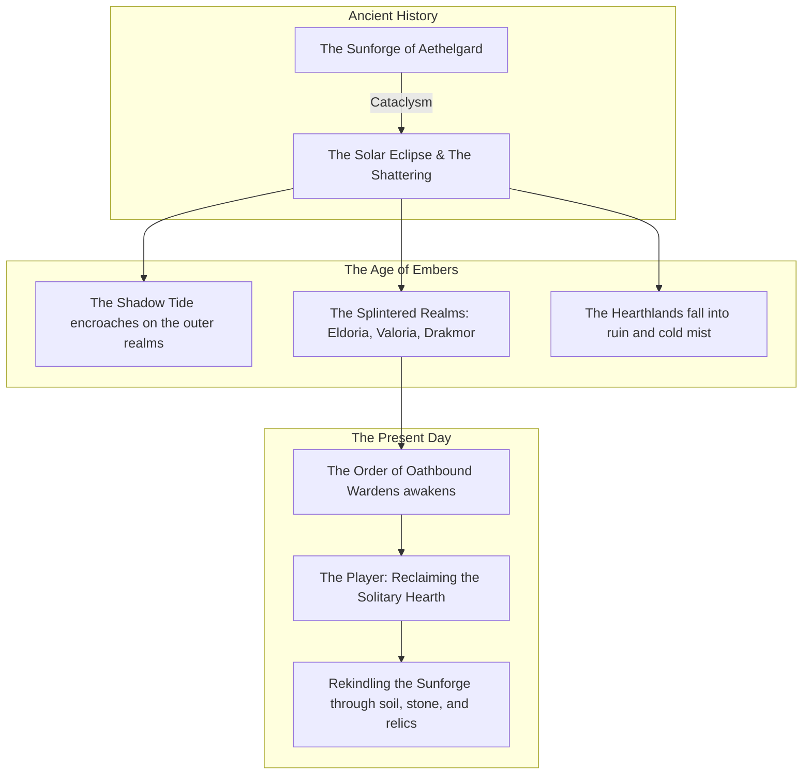
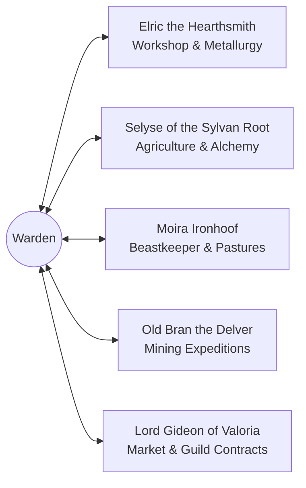
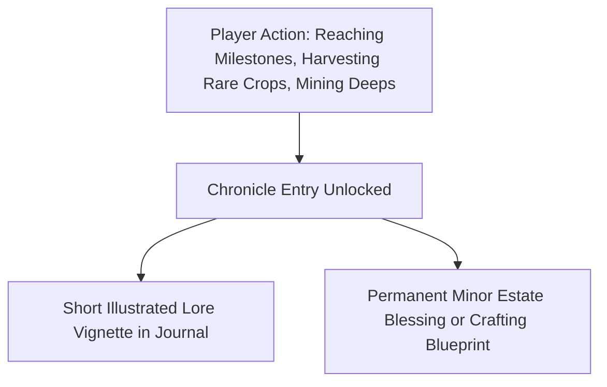

# SALVATION — AAA-QUALITY STUDIO AUDIT & IMPLEMENTATION ROADMAP
## DELIVERABLE 05: NARRATIVE DESIGN, LORE & WORLDBUILDING

**Studio Discipline:** Lead Narrative Designer & Worldbuilder  
**Focus:** Lore Foundation, Character Personas, Faction Geopolitics, The Meaning of Salvation & Narrative Delivery Architecture

---

### 1. ASSESSMENT OF CURRENT NARRATIVE CONTENT

#### Verified Canon in Codebase
Inspecting the repository reveals that Salvation currently possesses almost zero active narrative infrastructure:
- `src/features/lore/LorePage.jsx` contains exactly three sentences:
  1. *"Once united beneath a radiant banner, the kingdoms splintered after the Sunforge fell dark."*
  2. *"A fortress of iron and oathbound sentinels, holding back the shadow tide for a thousand winters."*
  3. *"A covenant sworn by the first heroes to rekindle the forge and bind fate to flame."*
- `src/core/services/CharacterService.jsx` assigns every new character the default title **"Warden Initiate"** and the bio: *"A quiet traveler sworn to the Sunforge, seeking relics and renown."*
- `src/core/data/citiesData.js` provides brief lore snippets for three starting cities: **Eldoria** (Nature Sanctuary), **Valoria** (City of Golden Spires), and **Drakmor** (The Forge of Warriors).
- `src/core/data/mockQuests.js` contains 3 disconnected quest cards with generic fantasy titles (*Echoes of the Lost Keep*, *Starlit Caravan*, *Trial of the Silver Fangs*) that have no gameplay impact.

#### Studio Assessment
The existing fragments provide an excellent conceptual spark—the "Sunforge", "Warden Initiate", "Shadow Tide", and the three distinct regional cities—but they lack connective tissue. Gameplay actions (farming turnips, smelting iron, digging copper) feel completely divorced from the narrative backdrop.

---

### 2. THE EXPANDED LORE BIBLE: THE FALL OF THE SUNFORGE

*(All content below is newly proposed studio narrative material, built upon the established canonical fragments).*

#### World History & Mythology
A millennium ago, the realm of Aethelgard basked in the warmth of the **Sunforge**—a colossal celestial engine situated atop the Mount of Dawn that held the nocturnal frost and abyssal horrors at bay. The ancient Wardens tended its perpetual flames, and civilization flourished in harmony with the living earth.

Seven generations ago, the **Great Eclipse** occurred. A creeping metaphysical chill known as the **Shadow Tide** seeped from the subterranean chasms, freezing the Sunforge's core and fracturing the empire into three squabbling survivor bastions:
1. **Eldoria in the High Boughs:** Sheltered by ancient living ironwood, preserving forgotten botanical rites and mystical druidic practices.
2. **Valoria upon the Sea of Gold:** The grand mercantile city that turned to commerce, guild contracts, and hoardable wealth to insulate itself against the gloom.
3. **Drakmor in the Ashen Basalt:** The martial forge-city where warriors hammer cold iron and brave volcanic rifts, believing only ruthless strength will survive the frost.

Between these three cities lie the **Hearthlands**—mist-shrouded ruins of once-fertile valleys, forgotten farmsteads, and deep mining shafts overrun by twilight beasts.

---

### 3. THE TRUE MEANING OF "SALVATION"

In most fantasy RPGs, "salvation" implies slaying an evil dark lord with a sword. In this game, **Salvation is agricultural, infrastructural, and communal restoration.**

> *"Salvation is not found on the battlefield; it is cultivated in the furrowed dirt. It is the steady glow of an iron forge on a winter night. It is bread baked from harvested wheat, warm fleece sheared from pasture sheep, and pure silver drawn from the deep dark to repair the ancient wards. To bring Salvation is to rebuild the sanctuary where life can endure."*

---

### 4. PLAYER IDENTITY: THE OATHBOUND WARDEN

The player is not an anonymous farmer or a disembodied ledger keeper. You are the **Last Warden Initiate of the Hearthlands**, dispatched by your chosen starting city (Eldoria, Valoria, or Drakmor) to reclaim a dilapidated ancestral estate sitting upon the ancient Leyline of Dawn.

#### The Origin & Purpose of the Farm (The Ancestral Hearth)
The player's estate was once the central granary and herbal sanctuary of the Sunforge Order. The soil here is infused with dormant solar leylines. When the player plants and nurtures crops, the vitality released into the earth pushes back the encroaching Shadow Mist, physically unlocking deeper mining strata and safer trade routes.

#### The Mystery of the Hollow Mines (The Slumbering Veins)
The mines below the estate are not mere gravel pits; they are the ancient cooling vents of the Sunforge itself. As the player mines deeper through the Six Strata (Surface Quarry -> Deep Shaft -> Subterranean Basin -> Abyssal Rift -> Void Core -> The Sunforge Anvil), they uncover ancient automations, frozen celestial machinery, and lore tablets detailing why the forge went dark.

---

### 5. DRAMATIS PERSONAE: KEY NPCS & GUILD MENTORS

Rather than flooding the player with lengthy RPG cutscenes, narrative is delivered through **estate mentors and visiting traders** who offer guidance, personal questlines, and crafting techniques.

#### 1. Elric the Hearthsmith (The Workshop)
- **Archetype:** Weathered, one-eyed blacksmith who formerly served the Drakmor Ironfang Legion.
- **Role:** Guides the player through Smelter and Tool upgrades.
- **Personality:** Gruff, pragmatic, deeply respectful of honest metallurgy. *"Cold iron doesn't lie to you, Warden. Treat it right, and it holds your roof up when the wind screams."*
- **Personal Quest:** Repairing his master's shattered hammer using a bar of refined Voidsteel.

#### 2. Selyse of the Sylvan Root (The Farm)
- **Archetype:** Eldorian herbalist draped in living moss and woven linen.
- **Role:** Introduces seeds, seasonal cycles, and weather omens.
- **Personality:** Soft-spoken, meditative, yet fiercely protective of soil health. *"The seeds remember the Sunforge even if our scholars have forgotten. Listen to the soil before you strike it with iron."*
- **Personal Quest:** Breeding the legendary Sunroot Bloom to cleanse the corrupted northern plots.

#### 3. Moira Ironhoof (The Animal Pastures)
- **Archetype:** Ex-caravan teamster who found solace raising resilient beasts.
- **Role:** Guides the player in animal husbandry, pasture care, and feeding.
- **Personality:** Warm, boisterous, protective of her flock. *"Give a beast warm straw and honest grain, and it'll give you more loyalty than any noble in Valoria."*

#### 4. Old Bran the Delver (The Mines & Expeditions)
- **Archetype:** Retired miner with pickaxe calluses and stone-dust cough.
- **Role:** Unlocks deeper mining zones, provides scout reports, and warns of cavern hazards.
- **Personality:** Superstitious, observant, full of mine folklore. *"Hear that deep hum beneath the copper seam? That's not rock settling, lad. That's the mountain breathing."*

#### 5. High Commissioner Gideon (The Market & Contracts)
- **Archetype:** Elegant, perfumed emissary from the Valorian Merchant Consortium.
- **Role:** Brokers bulk trade orders, rare relic contracts, and estate tax exemptions.
- **Personality:** Cynical, polished, transactional, yet secretly hoping the Warden succeeds. *"Gold is simply frozen confidence, Warden. Supply the city with wheat, and Valoria will fund your private kingdom."*

---

### 6. THE THREE CITY FACTIONS & PROGRESSION IMPACT

Character creation begins with choosing a starting city. Currently in `citiesData.js`, this choice only stores a string on the character profile. We propose integrating city origins directly into narrative identity and passive gameplay perks:

| City Origin | Cultural Identity | Estate Starting Bonus | Narrative Arc |
|---|---|---|---|
| **Eldoria** (Forest Sanctuary) | Harmony with natural growth; reveres ancient groves. | **+10% Crop Growth Speed**, starts with rare Herb Seeds. | Focuses on cleansing corrupted soil and re-establishing the Sacred Sylvan Groves. |
| **Valoria** (Gilded Spires) | Mercantilism, ambitious enterprise, fine craftsmanship. | **+10% Market Selling Value**, starts with 150 bonus gold. | Focuses on rebuilding the trade highways and monopolizing high-end luxury crafts. |
| **Drakmor** (Forge of Warriors) | Hardship, metallurgical prowess, subterranean survival. | **+10% Mining Efficiency & Rare Ore Chance**, starts with Forged Pickaxe. | Focuses on unearthing the deep dwarven forges and armoring the frontier guard against beasts. |

---

### 7. NARRATIVE DELIVERY SYSTEM: THE WARDEN'S CHRONICLE

We explicitly reject forcing the player into long, unskippable dialogue boxes. In a management game, storytelling must reward player agency.

#### The Four Delivery Channels:
1. **The Warden's Chronicle (Replaces Mock Quests):** A leather-bound journal in the UI divided into *Chapters of Restoration*. Completing gameplay goals (e.g., "Harvest 50 Sunroots", "Reach Depth Tier 3", "Construct the Arcane Loom") unlocks short, evocative journal entries written by previous Wardens, accompanied by aesthetic sketch art.
2. **Item & Tool Inscriptions:** Every high-tier crop, ore, and tool carries rich flavor text. (e.g., *Voidsteel Pickaxe: "Forged in the cooling vents of the lower abyss. Its edges drink the dark, leaving veins of silver singing in the rock."*).
3. **Visiting NPC Vignettes:** Upon reaching major milestones (Farm Level 5, Mining Level 10), mentors visit the estate with brief 2-sentence voice/text greetings and grant specialized legacy recipes.
4. **Relic Salvage:** Expeditions occasionally return ancient fragmented tablets that can be deciphered in the Workshop for permanent passive lore bonuses.
