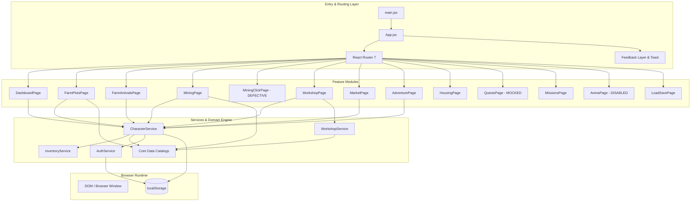

# SALVATION — AAA-QUALITY STUDIO AUDIT & IMPLEMENTATION ROADMAP
## DELIVERABLE 02: REPOSITORY & ARCHITECTURE AUDIT

**Target:** `projects/Salvation-rpg`  
**Inspected Date:** October 2026  
**Auditor:** Principal Game Architect & Lead Systems Engineer

---

### 1. CODEBASE TOPOLOGY & ARCHITECTURE BLUEPRINT

The application is structured as a single-page React 19 application bundled with Vite 6. Data management relies entirely on browser `localStorage` wrapped in singleton class services (`AuthService.jsx`, `CharacterService.jsx`, `WorkshopService.js`, and functional `inventoryService.js`).



---

### 2. FEATURE & COMPONENT STATUS INVENTORY

Every route and feature module in the repository has been audited against its actual implementation.

| Route / Module | Primary File(s) | Status | Verified Technical Diagnosis |
|---|---|---|---|
| **Home Landing** | `src/pages/Home.jsx` | **Implemented and Verified** | Static splash page with Navbar and Jumbotron. Works as intended. |
| **Character Creation** | `src/features/character/CreateCharacterPage.jsx` | **Partially Implemented** | City, Race, Gender, Name, and Review steps work. However, `SelectClass.jsx` is completely omitted from the wizard. Race icons are partially disabled (Orc, Dwarf, Werewolf disabled). |
| **Character Edit** | `src/features/character/EditCharacterPage.jsx` | **Partially Implemented (Orphaned)** | Fully coded component supporting race and image updates with gold check, but has NO route in `App.jsx` and is inaccessible in the live app. |
| **Dashboard** | `src/features/dashboard/DashboardPage.jsx` | **Implemented and Verified** | Displays player stats, active house, skill progress, expedition countdown, and top 3 missions. Re-renders on 1000ms timer. |
| **Farm Plots** | `src/features/farm/FarmPlotsPage.jsx` | **Implemented and Verified** | Seed planting, growth countdowns, harvesting, plot expansion, season modifiers, weather bonuses, and XP leveling fully operational. |
| **Farm Animals** | `src/features/farm/FarmAnimalsPage.jsx` | **Partially Implemented** | Only displays already-owned animals. Cannot buy animals here (must go to Market). Economic cycle times are severely distorted (6-14 hours). |
| **Farm Tasks** | `src/features/farm/FarmTasksPage.jsx` | **Implemented and Verified** | Daily, weekly, monthly delivery tasks with date-key resets. Payouts are currently worse than selling crops directly. |
| **Mining Passive** | `src/features/mining/MiningPage.jsx` | **Implemented and Verified** | 1,237-line monolith. Starts 5-hour sessions, auto-claims ticks, manages hirelings, forge upgrades, pickaxe upgrades, and boosters. |
| **Mining Clicker** | `src/features/mining/MiningClickPage.jsx` | **Implemented but Defective** | **CRITICAL DEFECT:** Calls `rollMiningTick` with wrong arguments; looks for non-existent `reward` property; discards `addItems` return value. Node destruction gives 0 XP and 0 items. |
| **Workshop / Crafting** | `src/features/workshop/WorkshopPage.jsx` | **Implemented and Verified** | Smelting, cooking, loom weaving, alchemy brewing with queue management and tool upgrades. Queue processing works across sessions. |
| **Global Market** | `src/features/market/MarketPage.jsx` | **Implemented and Verified** | Buy and sell loops for seeds, crops, ores, animal stock, and gear. Bulk selling modal works. Collapsed section persistence works. |
| **Adventure / Expeditions** | `src/features/adventure/AdventurePage.jsx` | **Implemented and Verified** | Expedition dispatch, 15m–90m timers, reward roll, and XP grant. |
| **Active Expedition View** | `src/features/adventure/ExpeditionActivePage.jsx` | **Implemented (Redundant)** | Exact duplicate of active expedition display and claim logic from `AdventurePage.jsx`. |
| **Housing / Residence** | `src/features/housing/HousingPage.jsx` | **Partially Implemented (Flavor Only)** | Upgrades house tier for gold. House buffs (`+2% health regen`) are purely visual text and have no mechanical code backing. |
| **Quest Log** | `src/features/quests/QuestsPage.jsx` | **UI-Only / Mocked** | Displays 3 static items from `mockQuests.js`. Detail page has dead "Continue Quest" button. Zero progress tracking or reward claiming. |
| **Missions** | `src/features/missions/MissionsPage.jsx` | **Implemented and Verified** | Dynamic sequential missions tracking player level, farm level, mining level, expeditions, and house ownership with claimable rewards. |
| **Combat / Arena** | `src/features/combat/ArenaPage.jsx` | **UI-Only / Disabled** | Route blocked via `OFFLINE_MODE` redirect. Outcome is purely `Math.random() > 0.45` with zero tactical gameplay. |
| **Guild & Party** | `src/features/guild/GuildPage.jsx` | **UI-Only / Disabled** | Route blocked via `OFFLINE_MODE` redirect. Hardcoded static list of 3 members and "Silver III" rank. |
| **Inventory Vault** | `src/features/character/InventoryPage.jsx` | **Partially Implemented** | Unified view of all inventory items, sorting and filtering. Read-only: cannot use, equip, or drop items. |
| **Save / Load System** | `src/features/system/LoadSavePage.jsx` | **Implemented but Defective** | Export JSON omits active expedition sessions, reset flags, and UI preferences. Importing save on fresh device triggers profile wipe. |
| **Dev Cheats Panel** | `src/features/system/DevCheatsPage.jsx` | **Implemented and Verified** | Password-protected (`ivy`). Allows setting levels, gold, house, and resetting state. Functional test utility. |
| **Lore Codex** | `src/features/lore/LorePage.jsx` | **UI-Only / Mocked** | 3 static sentences. No unlockable chronicles, discoveries, or narrative integration. |
| **Onboarding Guide** | `src/features/onboarding/OnboardingGuide.jsx` | **Missing / Orphaned** | Completed component file, but never imported or rendered anywhere in the application. |

---

### 3. ACTION TRACING: UI TO UNDERLYING STATE

#### A. Seed Planting & Crop Harvesting
```
[User clicks "Plant" in SeedSelector]
  │
  ├─► Validate requirements: farmLevel >= crop.levelRequired
  ├─► Check inventory: getItemCount(inventory, `seed-${cropId}`) >= count
  ├─► Calculate duration: crop.growMs * weatherMultiplier * seasonMultiplier
  ├─► Deduct seeds: removeItems(inventory, { [`seed-${cropId}`]: count })
  ├─► Update plot object: { cropId, plantedAt: Date.now(), harvestAt: Date.now() + duration }
  ├─► Persist state: CharacterService.updateMockProfile({ farmPlots, inventory })
  │
[Growth timer passes harvestAt]
  │
[User clicks "Harvest" on PlotCard]
  ├─► Verify plot.harvestAt <= Date.now()
  ├─► Calculate yield: crop.yieldAmount * weatherMultiplier * seasonMultiplier
  ├─► Award goods: addItems(inventory, { [crop.yieldId]: yieldAmount })
  ├─► Calculate farm XP: yieldAmount * 8
  ├─► Advance farm level if XP >= target
  ├─► Reset plot to empty: { id, cropId: null, plantedAt: null, harvestAt: null }
  ├─► Persist state: CharacterService.updateMockProfile({ farmPlots, inventory, farmLevel, farmXp })
  └─► Trigger feedback: pushReward(`+${yield} Crop`, anchor), pushReward(`+${xp} XP`, anchor)
```

#### B. Animal Purchase & Product Collection
```
[User on /market buys animal]
  │
  ├─► Validate gold >= animal.price * quantity
  ├─► Deduct gold from profile.stats.gold
  ├─► Update farmAnimals[animal.id]: { count: count + quantity, lastCollectedAt: Date.now() }
  └─► Persist: CharacterService.updateMockProfile(...)
  │
[User on /farm/animals waits produceEveryMs (6 to 14 hours)]
  │
[User clicks "Collect"]
  ├─► Calculate elapsed cycles: Math.floor((Date.now() - lastCollectedAt) / produceEveryMs)
  ├─► Calculate produce: cycles * count * produceAmount
  ├─► Award goods: addItems(inventory, { [produceId]: produce })
  ├─► Advance lastCollectedAt: lastCollectedAt + (cycles * produceEveryMs)
  └─► Persist: CharacterService.updateMockProfile(...)
```

#### C. Active Mining Clicker (VERIFIED DEFECT TRACE)
```
[User clicks "Mine" on MiningClickNode]
  │
  ├─► newNode.currentDurability -= clickDamage
  ├─► Code executes: rollMiningTick(miningLevel, clickEfficiency)
  │     └── BUG: rollMiningTick expects ({ miningLevel, pickaxeLevel, ... } = {})
  │     └── Passing numbers causes destructuring to fail and default to Level 1
  │     └── Function returns { tier, yieldMap, xpMultiplier, event }
  ├─► Code checks: reward = hitResult.reward || null
  │     └── BUG: hitResult has NO 'reward' property (it is 'yieldMap')
  │     └── reward is ALWAYS null; newPendingItems is ALWAYS empty
  │
[Node reaches 0 durability]
  ├─► Code executes: addItems(totalItemsToSync)
  │     └── BUG: addItems(inventory, items) takes 2 arguments.
  │     └── Calling addItems with 1 argument returns undefined/corrupted state.
  │     └── Return value is NOT assigned to finalUpdates! Loot vanishes forever.
  ├─► Code calculates: xpEarned = clickBaseXp * 10
  │     └── BUG: clickBaseXp relies on ore.xp, which does not exist in miningOres.
  │     └── xpEarned is 0.
  └─► Result: Node disappears, awards 0 XP, awards 0 items. 100% defective.
```

---

### 4. TECHNICAL DEBT & DUPLICATION REGISTER

#### 1. Redundant Data Directories
- `src/data/farmData.js` is an exact duplicate of `src/core/data/farmData.js` (FC comparison: 0 differences).
- `src/data/miningData.js` is an exact duplicate of `src/core/data/miningData.js` (FC comparison: 0 differences).
- All source files import from `src/core/data/`. The entire `src/data/` directory is dead unreferenced code.

#### 2. Duplicate Stylesheets & Dead CSS
- `src/App.css` and `src/core/styles/App.css` are duplicate files with minor string variations (`.jpg` vs `.webp`).
- `src/App.jsx` imports `./core/styles/App.css` and `./core/styles/styles.css`. `src/App.css` is completely dead code.
- Both `src/core/styles/index.css` and `src/core/styles/App.css` execute `@import "tailwindcss";`, leading to duplicate compilation and bloated bundle output.

#### 3. Orphaned Components
- `src/features/character/SelectClass.jsx` — fully implemented component, completely detached from the creation flow.
- `src/features/character/EditCharacterPage.jsx` — fully implemented component, lazy loaded in `App.jsx`, but lacks a `<Route>`.
- `src/features/onboarding/OnboardingGuide.jsx` — never imported.
- `src/core/services/NotificationService.jsx` — never imported.
- `src/shared/auth/RegisteForm.tsx` — the only TypeScript file in the project, never imported.
- `src/features/auth/LoginPage.jsx` and `RegisterPage.jsx` — never routed.

#### 4. Hardcoded & Broken Asset Filenames
- `miningData.js` lines 159, 168, 177:
  - `/pickaxe/mythril.webp` -> disk file is `mythril_pickaxe.webp`
  - `/pickaxe/voidsteel.webp` -> disk file is `voidsteel_pickaxe.webp`
  - `/pickaxe/starforge.webp` -> disk file is `starforge_pickaxe.webp`
- `citiesData.js` line 57:
  - `backgroundImage: '/cities/DarkmorCity.png'` -> typo in filename versus city name `Drakmor`.
- `public/pickaxe/20260210_1041_Image Generation_simple_compose_01kh3etckxfwk9a480hc297kd6.webp` — unrenamed raw AI output file.

---

### 5. VERIFIED ESLINT DEFECTS

Running `npm run lint` generates 3 breaking errors:
1. `src/core/services/CharacterService.jsx:45:11`: `'activeZoneId' is assigned a value but never used.`
2. `src/core/services/CharacterService.jsx:45:25`: `'unlockedZones' is assigned a value but never used.`
3. `src/features/character/SelectCity.jsx:4:78`: `'onPrev' is defined but never used.`

---

### 6. SAVE/LOAD VULNERABILITY AUDIT

Inspecting `src/features/system/LoadSavePage.jsx` reveals an incomplete backup implementation:
```javascript
const STORAGE_KEYS = [
  'accessToken',
  'refreshToken',
  'mockUsers',
  'mockSessionUser',
  'mockCharacters',
  'mockProfiles',
  'mockNotifications',
];
```

**Missing Storage Keys during Export:**
- `expeditionSession:${username}` — active expeditions in progress are dropped.
- `profileSystemReset:${username}` — **CRITICAL:** When an exported save is loaded on a clean browser, this key is missing. On the next call to `CharacterService.getMockProfile()`, lines 350–394 execute an automatic profile wipe, resetting character level, stats, farm land size, and mining level back to default starter cottage values.
- `arenaHistory` — duel logs dropped.
- `marketCollapsedSections` & `marketBulkSellConfirmDisabled` — UI preferences lost.
